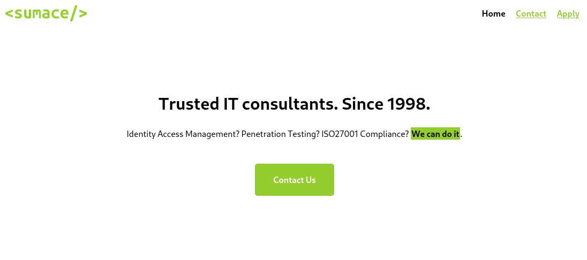

# Skills Assessment - File Inclusion

## Scenario

You have been contracted by `Sumace Consulting Gmbh` to carry out a web application penetration test against their main website. During the kickoff meeting, the CISO mentioned that last year's penetration test resulted in zero findings, however they have added a job application form since then, and so it may be a point of interest.

