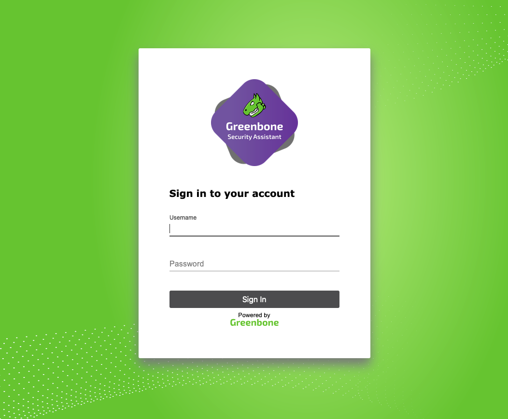
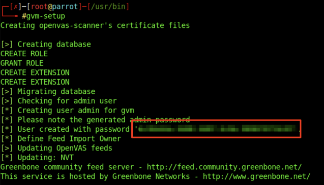

# Getting Started with OpenVAS

---

[OpenVAS](https://openvas.org/), by Greenbone Networks, is a publicly available vulnerability scanner. Greenbone Networks has an entire Vulnerability Manager, part of which is the OpenVAS scanner. Greenbone's Vulnerability Manager is also open to the public and free to use. OpenVAS has the capabilities to perform network scans, including authenticated and unauthenticated testing.



We will get started with using OpenVAS by following the installation instruction below for Parrot Security. The tool is pre-installed on the host provided in a later section.

---

## Installing Package

First, we can start by installing the tool:

```shellsession
hiimeins@htb[/htb]$ sudo apt-get update && apt-get -y full-upgrade
hiimeins@htb[/htb]$ sudo apt-get install gvm && openvas
```

Next, to begin the installation process, we can run the following command below:

```shellsession
hiimeins@htb[/htb]$ gvm-setup
```

This will begin the setup process and take up to 30 minutes.



---

## Starting OpenVas

Finally, we can start OpenVas:

```shellsession
hiimeins@htb[/htb]$ gvm-start
```

![Terminal output showing GVM/OpenVAS services starting, with Greenbone Security Assistant web UI available at <https://cdn.services-k8s.prod.aws.htb.systems/content/modules/108/openvas/gvmstart.png>)

**Note:** The VM provided in the `OpenVAS Skills Assessment` section has OpenVAS pre-installed and the targets running. You can go to that section and start the VM and use OpenVAS throughout the module, which can be accessed at `https://< IP >:8080`. The OpenVAS credentials are: `htb-student`:`HTB_@cademy_student!`. You may also use these credentials to SSH into the target VM to configure OpenVAS.
