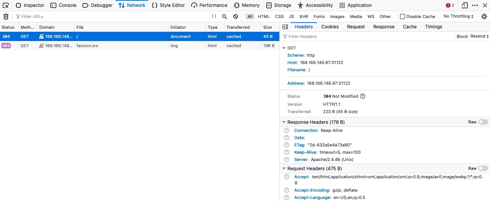

# HTTP Headers

We have seen examples of HTTP requests and response headers in the previous section. Such HTTP headers pass information between the client and the server. Some headers are only used with either requests or responses, while some other general headers are common to both.

Headers can have one or multiple values, appended after the header name and separated by a colon. We can divide headers into the following categories:

1. `General Headers`
2. `Entity Headers`
3. `Request Headers`
4. `Response Headers`
5. `Security Headers`

It is important to note that this five-way split comes from the original HTTP/1.1 specification, [RFC 2616](https://www.rfc-editor.org/info/rfc2616/), which was obsoleted back in 2014 by RFC 7230-7235, which were themselves obsoleted in 2022 by the current specification, [RFC 9110](https://www.rfc-editor.org/rfc/rfc9110.html). RFC 9110 no longer organizes fields this way. It groups them by function instead (representation metadata, content negotiation, authentication, caching, and so on). The categories below are kept as a simplified mental model for learning; each section notes where that type of header actually lives in the current specs.

Let's discuss each of these categories.

---

## General Headers

`General headers` is an RFC 2616 term for fields used in both HTTP requests and responses. They are contextual and are used to `describe the message rather than its contents`. RFC 9110 dropped this category and instead defines fields individually; [Section 5](https://www.rfc-editor.org/rfc/rfc9110.html#section-5) covers field syntax in general.

| **Header** | **Example** | **Description** |
| --- | --- | --- |
| `Date` | `Date: Wed, 16 Feb 2022 10:38:44 GMT` | Holds the date and time at which the message originated. It's preferred to convert the time to the standard [UTC](https://en.wikipedia.org/wiki/Coordinated_Universal_Time) time zone. |
| `Connection` | `Connection: close` | Dictates if the current network connection should stay alive after the request finishes. Two commonly used values for this header are `close` and `keep-alive`. The `close` value from either the client or server means that they would like to terminate the connection, while the `keep-alive` header indicates that the connection should remain open to receive more data and input. |
| `Cache-Control` | `Cache-Control: no-store` | Controls whether and how the message may be cached by browsers and intermediate proxies. From a security standpoint, responses containing sensitive data (session tokens, personal information) should set `no-store` so that data isn't written to disk or shared caches. |

---

## Entity Headers

Similar to general headers, `Entity Headers` is another RFC 2616 term, for fields `common to both the request and response`. These headers are used to `describe the content` (entity) transferred by a message. They are usually found in responses and POST or PUT requests. RFC 9110 replaced this category with [Section 8, Representation Data and Metadata](https://www.rfc-editor.org/rfc/rfc9110.html#section-8), calling these `representation header fields` rather than `entity headers`, but the older term is still widely used in practice.

| **Header** | **Example** | **Description** |
| --- | --- | --- |
| `Content-Type` | `Content-Type: text/html` | Used to describe the media type of the resource being transferred, e.g. `text/html`, `application/json`, or `application/octet-stream`. The value is automatically added by the browser on the client-side and returned in the server response. The `charset` field denotes the encoding standard, such as [UTF-8](https://developer.mozilla.org/en-US/docs/Glossary/UTF-8). |
| `Content-Length` | `Content-Length: 385` | Holds the size of the entity being passed, in bytes. This header is necessary as the server uses it to read data from the message body, and is automatically generated by the browser and tools like cURL. |
| `Content-Encoding` | `Content-Encoding: gzip` | Data can undergo multiple transformations before being passed. For example, large amounts of data can be compressed to reduce the message size. The type of encoding being used should be specified using the `Content-Encoding` header. |
| `Transfer-Encoding` | `Transfer-Encoding: chunked` | Specifies an encoding applied to safely transfer the body over HTTP/1.1, independent of the underlying content. The `chunked` value lets a server stream a response without knowing its total length upfront. Inconsistent handling of `Transfer-Encoding` and `Content-Length` between a front-end proxy and back-end server is the root cause of [HTTP request smuggling attacks](https://en.wikipedia.org/wiki/HTTP_request_smuggling). |
| `Boundary` | `Content-Type: multipart/form-data; boundary=b4e4fbd93540` | A parameter of the `Content-Type` header, rather than a standalone header, used as a marker to separate content when a message contains more than one part, such as a multipart form submission. The boundary value is then used as `--b4e4fbd93540` to separate the different parts of the form. |

---

## Request Headers

The client sends `Request Headers` in an HTTP transaction (another RFC 2616 category). These headers are `used in an HTTP request and do not relate to the content` of the message. RFC 9110 no longer groups them together: most are defined next to the concept they relate to (`Host` in [RFC 9110 §7.2](https://www.rfc-editor.org/info/rfc9110/#section-7.2), `Accept` under content negotiation, `Authorization` under [HTTP Authentication](https://www.rfc-editor.org/rfc/rfc9110.html#section-11), `Cookie` in [RFC 6265](https://www.rfc-editor.org/rfc/rfc6265.html)), with only `Referer` and `User-Agent` left in RFC 9110's [Request Context Fields](https://www.rfc-editor.org/rfc/rfc9110.html#section-10.1) section. The following headers are commonly seen in HTTP requests.

| **Header** | **Example** | **Description** |
| --- | --- | --- |
| `Host` | `Host: www.inlanefreight.com` | Used to specify the host being queried for the resource. This can be a domain name or an IP address. HTTP servers can be configured to host different websites, which are revealed based on the hostname. This makes the host header an important enumeration target, as it can indicate the existence of other hosts on the target server, and a common target for [Host header injection attacks](https://en.wikipedia.org/wiki/HTTP_header_injection). |
| `User-Agent` | `User-Agent: curl/7.77.0` | The `User-Agent` header is used to describe the client requesting resources. This header can reveal a lot about the client, such as the browser, its version, and the operating system. |
| `Referer` | `Referer: http://www.inlanefreight.com/` | Denotes where the current request is coming from. For example, clicking a link from Google search results would make `https://google.com` the referer. Trusting this header can be dangerous as it can be easily manipulated, leading to unintended consequences. |
| `Accept` | `Accept: */*` | The `Accept` header describes which media types the client can understand. It can contain multiple media types separated by commas. The `*/*` value signifies that all media types are accepted. |
| `Cookie` | `Cookie: PHPSESSID=b4e4fbd93540` | Contains cookie-value pairs in the format `name=value`. A [cookie](https://developer.mozilla.org/en-US/docs/Web/HTTP/Guides/Cookies) is a piece of data stored on the client-side and on the server, which acts as an identifier. These are passed to the server per request, thus maintaining the client's access. Cookies can also serve other purposes, such as saving user preferences or session tracking. There can be multiple cookies in a single header, separated by a semicolon. |
| `Authorization` | `Authorization: Basic cGFzc3dvcmQK` | Another method for the server to identify clients. Common schemes include `Basic`, `Bearer` (used for tokens such as JWTs, and `Digest`). Unlike a cookie, the value is generated and attached by the client on every request rather than being stored and sent automatically by the browser. |
| `X-Forwarded-For` | `X-Forwarded-For: 203.0.113.5` | Added by proxies and load balancers to record the originating IP address of a client whose connection is being relayed. Since it is client-controllable, it can often be spoofed to bypass IP-based access controls, rate limiting, or blocklists. |

Since fields are now scattered across multiple documents, the authoritative, continuously updated list of every registered HTTP header, request and response alike, is the [IANA HTTP Field Name Registry](https://www.iana.org/assignments/http-fields/http-fields.xhtml), which links each name to the RFC that defines it.

---

## Response Headers

`Response Headers` is the response-side equivalent RFC 2616 category, `used in an HTTP response and do not relate to the content`. `Location`, `Server`, `Allow`, and `Retry-After` are grouped under RFC 9110's [Response Context Fields](https://www.rfc-editor.org/rfc/rfc9110.html#section-10.2), while `Set-Cookie` is defined separately in [RFC 6265](https://www.rfc-editor.org/rfc/rfc6265.html) and `WWW-Authenticate` under [HTTP Authentication](https://www.rfc-editor.org/rfc/rfc9110.html#section-11). The following headers are commonly seen in HTTP responses.

| **Header** | **Example** | **Description** |
| --- | --- | --- |
| `Server` | `Server: Apache/2.4.41 (Ubuntu)` | Contains information about the HTTP server, which processed the request. It can be used to gain information about the server, such as its version, and enumerate it further. Many hardening guides recommend suppressing or genericizing this header to reduce information disclosure. |
| `Location` | `Location: https://www.inlanefreight.com/login` | Used with redirect status codes (`3xx`) to tell the client where the requested resource can be found. If the redirect target is built from unvalidated user input, this header can lead to [open redirect vulnerabilities](https://community.owasp.org/attacks/open_redirect). |
| `Set-Cookie` | `Set-Cookie: PHPSESSID=b4e4fbd93540; Secure; HttpOnly; SameSite=Strict` | Sends a cookie for the client to store and return on future requests, using the same `name=value` format as the `Cookie` request header. Security-relevant attributes can be appended: `Secure` (only send over HTTPS), `HttpOnly` (inaccessible to client-side JavaScript, mitigating cookie theft via XSS), and `SameSite` (`Strict`, `Lax`, or `None`, restricting when the cookie is sent on cross-site requests as a [CSRF](https://community.owasp.org/attacks/csrf) defense). |
| `WWW-Authenticate` | `WWW-Authenticate: Basic realm="localhost"` | Notifies the client about the type of authentication required to access the requested resource, and is sent alongside a `401 Unauthorized` status code. |

---

## Security Headers

`Security Headers` are a practical, industry-coined grouping (popularized by the [OWASP Secure Headers Project](https://owasp.org/www-project-secure-headers/)) for response headers that instruct the browser to follow certain security rules and policies.

| **Header** | **Example** | **Description** |
| --- | --- | --- |
| `Content-Security-Policy` | `Content-Security-Policy: script-src 'self'` | Dictates the website's policy towards externally injected resources. This could be JavaScript code as well as script resources. This header instructs the browser to accept resources only from certain trusted domains, hence preventing attacks such as [Cross-site scripting (XSS)](https://community.owasp.org/attacks/xss/). |
| `Strict-Transport-Security` | `Strict-Transport-Security: max-age=31536000` | Prevents the browser from accessing the website over the plaintext HTTP protocol, and forces all communication to be carried over the secure HTTPS protocol. This prevents attackers from sniffing web traffic and accessing protected information such as passwords or other sensitive data. |
| `X-Content-Type-Options` | `X-Content-Type-Options: nosniff` | Tells the browser to strictly follow the declared `Content-Type` and never try to guess (`sniff`) a resource's actual MIME type. Without it, a browser may render a file as a different type than declared, which has historically been abused to turn file upload functionality into stored XSS. |
| `X-Frame-Options` | `X-Frame-Options: DENY` | Controls whether the page can be rendered inside a `<frame>`, `<iframe>`, or `<object>`, protecting against [clickjacking](https://owasp.org/www-community/attacks/Clickjacking) attacks. Largely superseded by the `frame-ancestors` directive in `Content-Security-Policy`, but still widely deployed for legacy browser support. |
| `Access-Control-Allow-Origin` | `Access-Control-Allow-Origin: https://www.inlanefreight.com` | Part of [Cross-Origin Resource Sharing (CORS)](https://developer.mozilla.org/en-US/docs/Web/HTTP/CORS), it tells the browser which origins are allowed to read the response to a cross-origin request. Misconfigurations, such as reflecting the requester's `Origin` header or using a wildcard (`*`) alongside credentials, are a common source of CORS-based vulnerabilities. |
| `Referrer-Policy` | `Referrer-Policy: origin` | Dictates whether the browser should include the value specified via the `Referer` header or not. It can help in avoiding disclosing sensitive URLs and information while browsing the website. |

**Note:** This section only mentions a small subset of commonly seen HTTP headers. There are many other contextual headers that can be used in HTTP communications. It's also possible for applications to define custom headers based on their requirements. A complete list of standard HTTP headers can be found [here](https://developer.mozilla.org/en-US/docs/Web/HTTP/Headers).

---

## cURL

In the previous section, we saw how using the `-v` flag with cURL shows us the full details of the HTTP request and response. If we were only interested in seeing the response headers, then we can use the `-I` flag to send a `HEAD` request and only display the response headers. Furthermore, we can use the `-i` flag to display both the headers and the response body (e.g. HTML code). The difference between the two is that `-I` sends a `HEAD` request (as we will see in the next section), while `-i` sends any request we specify and prints the headers as well.

The following command shows an example output of using the `-I` flag. This output is an illustrative composite assembled to demonstrate the headers discussed above; it isn't a literal capture, and a real target will only ever return the headers it's actually configured to send. Try the command yourself and compare:

```
        shellsession
hiimeins@htb[/htb]$ curl -I https://www.inlanefreight.com

Host: www.inlanefreight.com
User-Agent: Mozilla/5.0 (Macintosh; Intel Mac OS X 10_14_5) AppleWebKit/605.1.15 (KHTML, like Gecko)
Cookie: cookie1=298zf09hf012fh2; cookie2=u32t4o3tb3gg4
Accept: text/plain
Referer: https://www.inlanefreight.com/
Authorization: Basic cGFzc3dvcmQK
X-Forwarded-For: 203.0.113.5

Date: Sun, 06 Aug 2020 08:49:37 GMT
Connection: keep-alive
Cache-Control: no-store
Content-Length: 26012
Content-Type: text/html; charset=UTF-8
Content-Encoding: gzip
Server: Apache/2.4.41 (Ubuntu)
Set-Cookie: sessionId=e8c2d9f1a4; Secure; HttpOnly; SameSite=Strict
WWW-Authenticate: Basic realm="localhost"
Content-Security-Policy: script-src 'self'
Strict-Transport-Security: max-age=31536000
X-Content-Type-Options: nosniff
X-Frame-Options: DENY
Access-Control-Allow-Origin: https://www.inlanefreight.com
Referrer-Policy: origin
```

**Exercise:** Try to go through all of the above headers, and see whether you can recall the usage for each of them.

In addition to viewing headers, cURL also allows us to set request headers with the `-H` flag, as we will see in a later section. Some headers, like the `User-Agent` or `Cookie` headers, have their own flags. For example, we can use the `-A` to set our `User-Agent`, as follows:

```
        shellsession
hiimeins@htb[/htb]$ curl https://www.inlanefreight.com -A 'Mozilla/5.0'

<!DOCTYPE HTML PUBLIC "-//IETF//DTD HTML 2.0//EN">
<html><head>
...SNIP...
```

**Exercise:** Try to use the `-I` or the `-v` flags with the above example, to ensure that we did change our User-Agent with the `-A` flag.

---

## Browser DevTools

Let's see how we can preview the HTTP headers using the browser devtools. Just as we did in the previous section, we can go to the `Network` tab to view the different requests made by the page. We can click on any of the requests to view its details:



In the first `Headers` tab, we see both the HTTP request and HTTP response headers. The devtools automatically arrange the headers into sections, but we can click on the `Raw` button to view their details in their raw format. Furthermore, we can check the `Cookies` tab to see any cookies used by the request, as discussed in an upcoming section.
