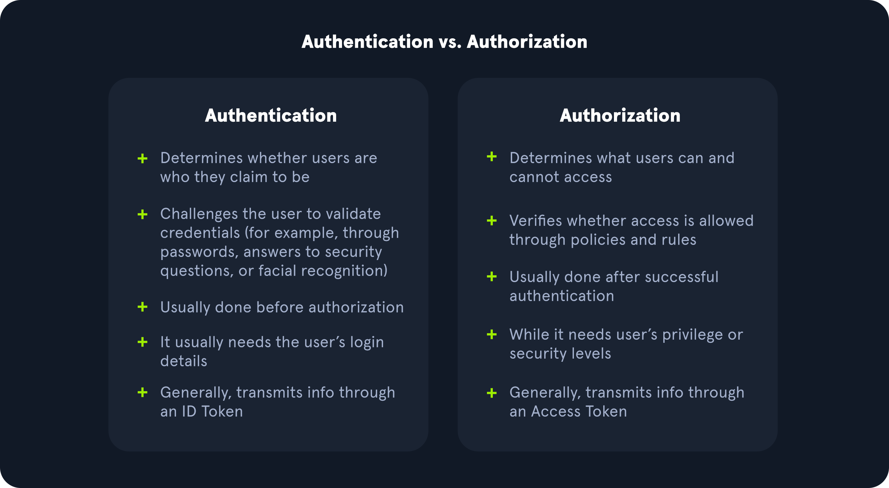

# What is Authentication

---

Authentication is defined as "`The process of verifying a claim that a system entity or system resource has a certain attribute value`" in [RFC 4949](https://datatracker.ietf.org/doc/rfc4949/). In information security, authentication is the process of confirming an entity's identity, ensuring they are who they claim to be. On the other hand, authorization is an "`approval that is granted to a system entity to access a system resource`". While this module will not cover authorization in depth, understanding the major difference between it and authentication is vital to approaching this module with the appropriate mindset.

The most widespread authentication method in web applications is `login forms`, where users enter their username and password to prove their identity. Login forms can be found on many websites, including email providers, online banking, and HTB Academy:

https://academy.hackthebox.com/login

Authentication is probably the most widely used security measure and the first line of defense against unauthorized access. As web application penetration testers, we aim to verify if authentication is implemented securely. This module will focus on various exploitation methods and techniques against login forms to bypass authentication and gain unauthorized access.

---

## Common Authentication Methods

Information technology systems can implement different authentication methods. Typically, they can be divided into the following three major categories:

- Knowledge-based authentication
- Ownership-based authentication
- Inherence-based authentication

#### Knowledge

Authentication based on knowledge factors relies on something that the user knows to prove their identity. The user provides information such as passwords, passphrases, PINs, or answers to security questions.

#### Ownership

Authentication based on ownership factors relies on something the user possesses. The user proves their identity by demonstrating the ownership of a physical object or device, such as an ID card, security token, or smartphone with an authentication app.

#### Inherence

Lastly, authentication based on inherence factors relies on something the user is or does. This includes biometric factors such as fingerprints, facial patterns, and voice recognition, or signatures. Biometric authentication is highly effective since biometric traits are inherently tied to an individual user.

| Knowledge | Ownership | Inherence |
| --- | --- | --- |
| Password | ID card | Fingerprint |
| PIN | Security Token | Facial Pattern |
| Answer to Security Question | Authenticator App | Voice Recognition |

---

## Single-Factor Authentication vs Multi-Factor Authentication

Single-factor authentication relies solely on a single method of authentication. For instance, password authentication solely relies on knowledge of the password. As such, it is a single-factor authentication method.

On the other hand, `multi-factor authentication (MFA)` involves multiple authentication methods. For instance, if a web application requires a password and a time-based one-time password (TOTP), it relies on knowledge of the password and ownership of the TOTP device for authentication. In the case where exactly two factors are required, MFA is commonly referred to as `two-factor authentication (2FA)`.
