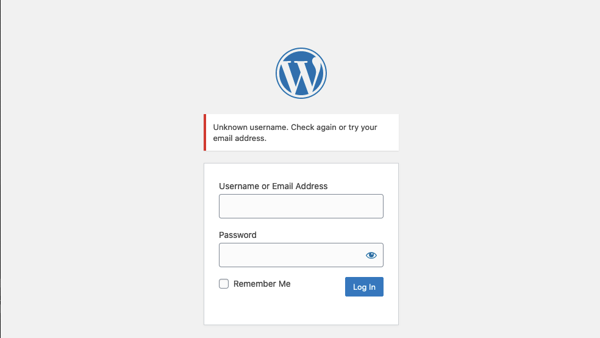
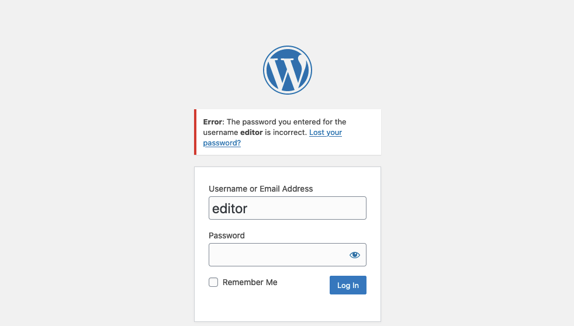
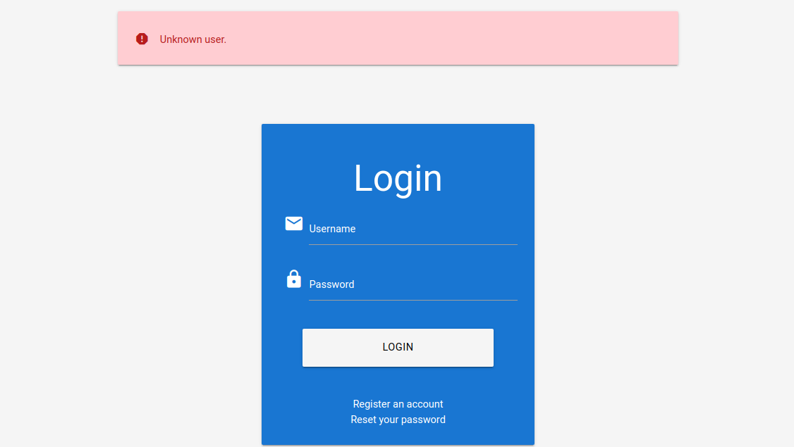
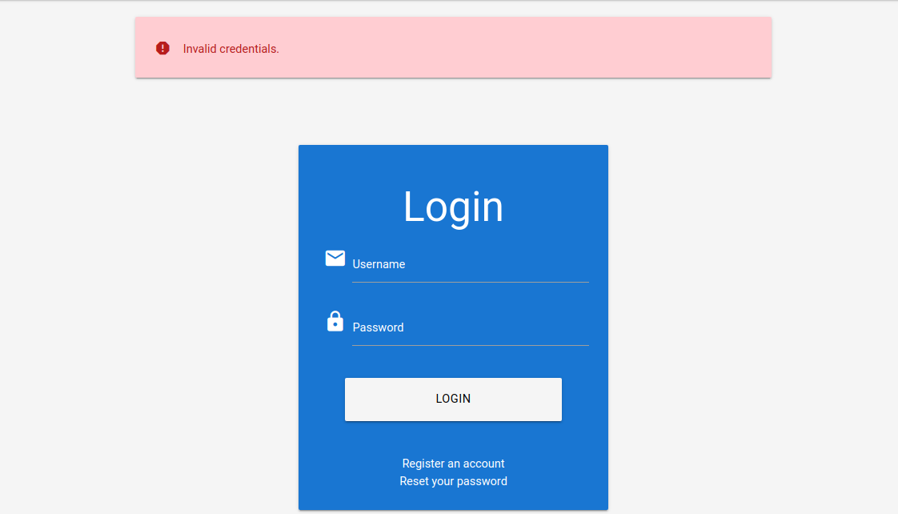

# Enumerating Users

---

User enumeration vulnerabilities occur when a web application responds differently to registered and valid versus invalid inputs for authentication endpoints. User enumeration vulnerabilities often occur in functions that rely on the user's username, such as user login, registration, and password reset.

Web developers frequently overlook user enumeration vectors, assuming that information such as usernames is not confidential. However, usernames can be considered confidential if they are the primary identifier required for authentication in web applications. Moreover, users tend to use the same username across various services, including web applications, as well as FTP, RDP, and SSH. Since many web applications allow us to identify usernames, we can enumerate valid usernames and use them for further attacks on authentication. This is often possible because web applications typically use a username or the user's email address as the primary identifier for users.

---

## User Enumeration Theory

Protection against username enumeration attacks can negatively impact user experience. A web application that reveals whether a username exists can help a legitimate user identify if they have mistyped their username. Still, the same applies to an attacker trying to determine valid usernames. Even well-known and mature applications, like WordPress, allow for user enumeration by default. For instance, if we attempt to log in to WordPress with an invalid username, we get the following error message:

http://wordpress.htb/



On the other hand, a valid username results in a different error message:

http://wordpress.htb/



As we can see, user enumeration can be a security risk that a web application deliberately accepts to provide a service. As another example, consider a chat application enabling users to chat with others. This application might provide a functionality to search for users by their username. While this functionality can be used to enumerate all users on the platform, it is also essential to the service provided by the web application. As such, user enumeration is not always a security vulnerability. Nevertheless, it should be avoided if possible as a defense-in-depth measure. For instance, in our example web application, user enumeration can be avoided by not using the username during login, but an email address instead.

---

## Enumerating Users via Differing Error Messages

To obtain a list of valid users, an attacker typically requires a wordlist of usernames to test. Usernames are often far less complicated than passwords. They rarely contain special characters when they are not email addresses. A list of common users allows an attacker to narrow the scope of a brute-force attack or carry out targeted attacks (leveraging OSINT) against support employees or users. Also, a common password could be easily sprayed against valid accounts, often leading to a successful account compromise. Additional methods for harvesting usernames include crawling a web application or utilizing publicly available information, such as company profiles on social networks. A good starting point is the wordlist collection [SecLists](https://github.com/danielmiessler/SecLists/tree/master/Usernames).

When we attempt to log in to the lab with an invalid username, such as `abc`, we can see the following error message:

http://<SERVER\_IP>:<PORT>/



On the other hand, when we attempt to log in with a registered user such as `htb-stdnt` and an invalid password, we can see a different error:

http://<SERVER\_IP>:<PORT>/



Let us exploit this difference in error messages returned and use SecLists's wordlist `xato-net-10-million-usernames.txt` to enumerate valid users with `ffuf`. We can specify the wordlist with the `-w` parameter, the POST data with the `-d` parameter, and the keyword `FUZZ` in the username to fuzz valid users. Finally, we can filter out invalid users by removing responses containing the string `Unknown user`:

```
        shellsession
hiimeins@htb[/htb]$ ffuf -w /opt/useful/seclists/Usernames/xato-net-10-million-usernames.txt -u http://172.17.0.2/index.php -X POST -H "Content-Type: application/x-www-form-urlencoded" -d "username=FUZZ&password=invalid" -fr "Unknown user"

<SNIP>

[Status: 200, Size: 3271, Words: 754, Lines: 103, Duration: 310ms]
    * FUZZ: consuelo
```

We successfully identified the valid username `consuelo`. We could now proceed by attempting to brute-force the user's password, as we will discuss in the following section.

---

## User Enumeration via Side-Channel Attacks

While differences in the web application's response are the simplest and most obvious way to enumerate valid usernames, we might also be able to enumerate valid usernames via side channels. Side-channel attacks do not directly target the web application's response, but rather extra information that can be obtained or inferred from it. An example of a side channel is the response timing, i.e., the time it takes for the web application's response to reach us. Suppose a web application does database lookups only for valid usernames. In that case, we might be able to measure a difference in the response time and enumerate valid usernames this way, even if the response is the same. User enumeration based on response timing is covered in the [Whitebox Attacks](https://academy.hackthebox.com/module/details/205) module.
