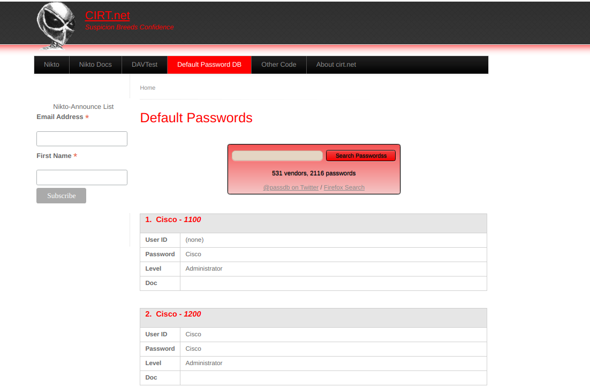
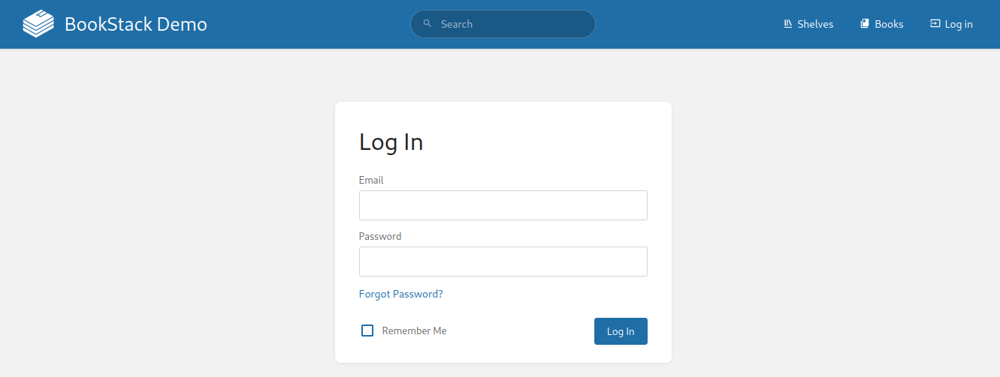
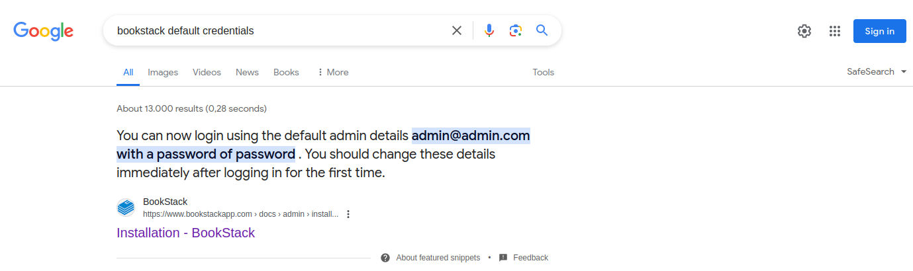

# Default Credentials

---

Many web applications are set up with default credentials to allow access after installation. However, these credentials need to be changed after the initial setup of the web application; otherwise, they provide an easy way for attackers to obtain authenticated access. As such, [Testing for Default Credentials](https://owasp.org/www-project-web-security-testing-guide/latest/4-Web_Application_Security_Testing/04-Authentication_Testing/02-Testing_for_Default_Credentials) is an essential part of authentication testing in OWASP's Web Application Security Testing Guide. According to OWASP, common default credentials include `admin` and `password`.

---

## Testing Default Credentials

Many platforms provide lists of default credentials for a wide variety of web applications. An example of this is the web database maintained by [CIRT.net](https://www.cirt.net/passwords). For instance, if we identified a Cisco device during a penetration test, we can search the database for default credentials for Cisco devices:

https://www.cirt.net/passwords

Further resources include [SecLists Default Credentials](https://github.com/danielmiessler/SecLists/tree/master/Passwords/Default-Credentials) as well as the [SCADA](https://github.com/scadastrangelove/SCADAPASS/tree/master) GitHub repository, which contains a list of default passwords for a variety of different vendors.

A targeted internet search is a different way of obtaining default credentials for a web application. Let us assume we stumble across a [BookStack](https://github.com/BookStackApp/BookStack) web application during an engagement:

http://bookstack.htb

We can try to search for default credentials by searching something like `bookstack default credentials`:

https://google.com/

As we can see, the results contain the installation instructions for BookStack, which state that the default admin credentials are `admin@admin.com:password`.
