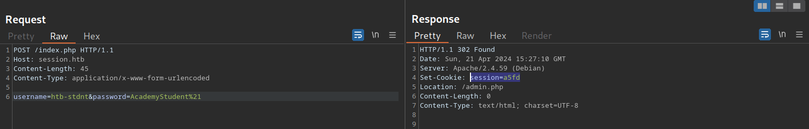
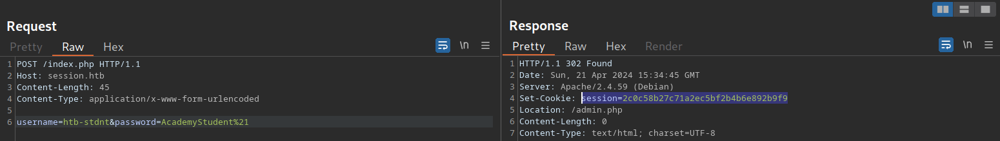
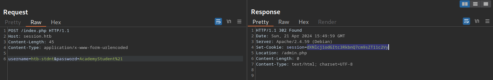
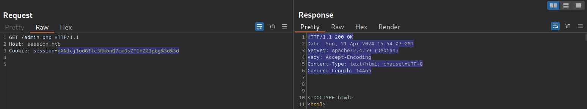

# Attacking Session Tokens

---

So far, we have focused on abusing flawed implementations of web application authentication. However, vulnerabilities related to authentication can arise not only from the implementation of the authentication itself but also from the handling of session tokens. Session tokens are unique identifiers that a web application uses to identify a user. More specifically, the session token is tied to the user's session. If an attacker can obtain a valid session token of another user, they can impersonate the user to the web application, thereby taking over their session.

---

## Brute-Force Attack

Suppose a session token does not provide sufficient randomness and is cryptographically weak. In that case, we can brute-force valid session tokens similarly to how we were able to brute-force valid password-reset tokens. This can occur if a session token is too short or contains static data that does not provide randomness to the token, i.e., the token provides [insufficient entropy](https://owasp.org/www-community/vulnerabilities/Insufficient_Entropy).

For instance, consider the following web application that assigns a four-character session token:



As we have seen in previous sections, a four-character string can easily be brute-forced. Thus, we can use the techniques and commands discussed in the `Brute-Force Attacks` sections to brute-force all possible session tokens and hijack all active sessions.

This scenario is relatively uncommon in the real world. In a slightly more common variant, the session token itself provides sufficient length; however, the token consists of hardcoded prepended and appended values, while only a small part of the session token is dynamic to provide randomness. For instance, consider the following session token assigned by a web application:



The session token is 32 characters long; thus, it seems infeasible to enumerate other users' valid sessions. However, let us send the login request multiple times and take note of the session tokens assigned by the web application, resulting in the following list of session tokens:

```
        txt
2c0c58b27c71a2ec5bf2b4b6e892b9f9
2c0c58b27c71a2ec5bf2b4546092b9f9
2c0c58b27c71a2ec5bf2b497f592b9f9
2c0c58b27c71a2ec5bf2b48bcf92b9f9
2c0c58b27c71a2ec5bf2b4735e92b9f9
```

As we can see, all session tokens are very similar. In fact, of the 32 characters, 28 are the same for all five captured sessions. The session tokens consist of the static string `2c0c58b27c71a2ec5bf2b4` followed by four random characters and the static string `92b9f9`, reducing the effective randomness of the session tokens. Since 28 out of 32 characters are static, there are only four characters we need to enumerate to brute-force all existing active sessions, enabling us to hijack all active sessions.

Another vulnerable example would be an incrementing session identifier. For instance, consider the following capture of successive session tokens:

```
        txt
141233
141234
141237
141238
141240
```

As we can see, the session tokens seem to be incrementing numbers. This makes enumeration of all past and future sessions trivial, as we simply need to increment or decrement our session token to obtain active sessions and hijack other users' accounts.

As such, it is crucial to capture multiple session tokens and analyze them to ensure that session tokens provide sufficient randomness to disallow brute-force attacks against them.

---

## Attacking Predictable Session Tokens

In a more realistic scenario, the session token does provide sufficient randomness on the surface. However, the generation of session tokens is not truly random; it can be predicted by an attacker with insight into the session token generation logic.

The simplest form of predictable session tokens contains encoded data we can tamper with. For instance, consider the following session token:



While this session token might seem random at first, a simple analysis reveals that it is base64-encoded data:

```
        shellsession
hiimeins@htb[/htb]$ echo -n dXNlcj1odGItc3RkbnQ7cm9sZT11c2Vy | base64 -d

user=htb-stdnt;role=user
```

As we can see, the cookie contains information about the user and the role tied to the session. However, there is no security measure in place that prevents us from tampering with the data. We can forge our own session token by manipulating the data and base64-encoding it to match the expected format, enabling us to forge an admin cookie:

```
        shellsession
hiimeins@htb[/htb]$ echo -n 'user=htb-stdnt;role=admin' | base64

dXNlcj1odGItc3RkbnQ7cm9sZT1hZG1pbg==
```

We can send this cookie to the web application to obtain administrative access:



The same exploit works for cookies containing differently encoded data. We should also keep an eye out for data in hexadecimal encoding or URL encoding. For instance, a session token containing hex-encoded data might look like this:


Just like before, we can forge an admin cookie:

```
        shellsession
hiimeins@htb[/htb]$ echo -n 'user=htb-stdnt;role=admin' | xxd -p

757365723d6874622d7374646e743b726f6c653d61646d696e
```

Another variant of session tokens contains the result of encrypting a data sequence. A weak cryptographic algorithm could lead to privilege escalation or authentication bypass, just like plain encoding. Improper handling of cryptographic algorithms or injection of user-provided data into the input of an encryption function can lead to vulnerabilities in the session token generation. However, it is often challenging to attack encryption-based session tokens in a blackbox approach without access to the source code responsible for generating the session token.
