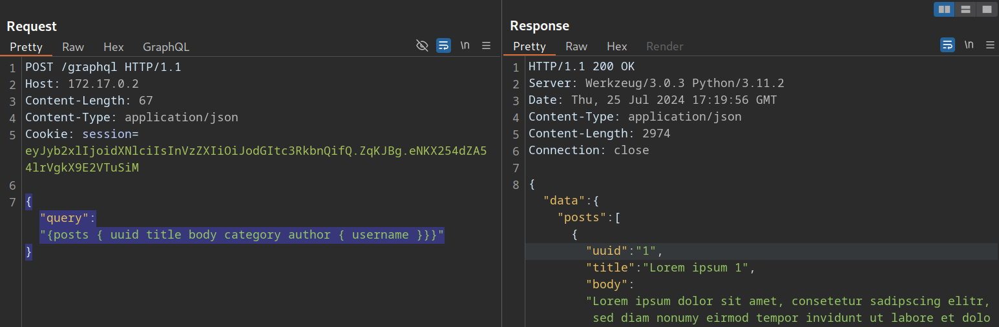
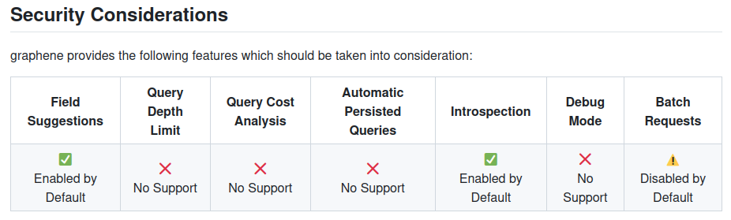
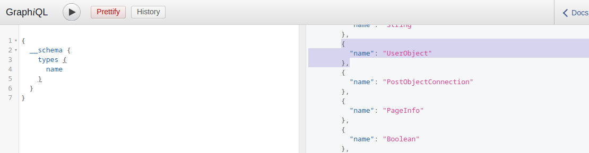
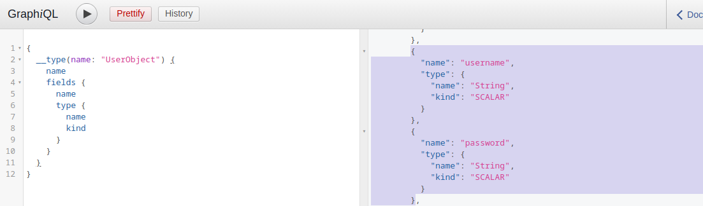

# Information Disclosure

---

Exploiting any service requires thorough enumeration and reconnaissance to identify all possible attack vectors. As attackers, we aim to obtain as much information about a service as possible.

---

## Identifying the GraphQL Engine

After logging in to the sample web application and investigating all functionality, we can observe multiple requests to the `/graphql` endpoints that contain GraphQL queries:



Thus, we can definitely say that the web application implements GraphQL. As a first step, we will identify the GraphQL engine used by the web application using the tool [graphw00f](https://github.com/dolevf/graphw00f). Graphw00f will send various GraphQL queries, including malformed queries, and can determine the GraphQL engine by observing the backend's behavior and error messages in response to these queries.

After cloning the git repository, we can run the tool using the `main.py` Python script. We will run the tool in fingerprint (`-f`) and detect mode (`-d`). We can provide the web application's base URL to let graphwoof attempt to find the GraphQL endpoint by itself:

```
        shellsession
hiimeins@htb[/htb]$ python3 main.py -d -f -t http://172.17.0.2

                +-------------------+
                |     graphw00f     |
                +-------------------+
                  ***            ***
                **                  **
              **                      **
    +--------------+              +--------------+
    |    Node X    |              |    Node Y    |
    +--------------+              +--------------+
                  ***            ***
                     **        **
                       **    **
                    +------------+
                    |   Node Z   |
                    +------------+

                graphw00f - v1.1.17
          The fingerprinting tool for GraphQL
           Dolev Farhi <dolev@lethalbit.com>
  
[*] Checking http://172.17.0.2/
[*] Checking http://172.17.0.2/graphql
[!] Found GraphQL at http://172.17.0.2/graphql
[*] Attempting to fingerprint...
[*] Discovered GraphQL Engine: (Graphene)
[!] Attack Surface Matrix: https://github.com/nicholasaleks/graphql-threat-matrix/blob/master/implementations/graphene.md
[!] Technologies: Python
[!] Homepage: https://graphene-python.org
[*] Completed.
```

As we can see, the graphwoof identified the GraphQL engine `Graphene`. Additionally, it provides us with the corresponding detailed page in the [GraphQL-Threat-Matrix](https://github.com/nicholasaleks/graphql-threat-matrix), which provides more in-depth information about the identified GraphQL engine:

https://github.com/nicholasaleks/graphql-threat-matrix



Lastly, by accessing the `/graphql` endpoint in a web browser directly, we can see that the web application runs a [graphiql](https://github.com/graphql/graphiql) interface. This enables us to provide GraphQL queries directly, which is a lot more convenient than running the queries through Burp, as we do not need to worry about breaking the JSON syntax.

---

## Introspection

[Introspection](https://graphql.org/learn/introspection/) is a GraphQL feature that enables users to query the GraphQL API about the structure of the backend system. As such, users can use introspection queries to obtain all queries supported by the API schema. These introspection queries query the `__schema` field.

For instance, we can identify all GraphQL types supported by the backend using the following query:

```
        graphql
{
  __schema {
    types {
      name
    }
  }
}
```

The results contain basic default types, such as `Int` or `Boolean`, but also all custom types, such as `UserObject`:

http://<SERVER\_IP>:<PORT>/graphql



Now that we know a type, we can follow up and obtain the name of all of the type's fields with the following introspection query:

```
        graphql
{
  __type(name: "UserObject") {
    name
    fields {
      name
      type {
        name
        kind
      }
    }
  }
}
```

In the result, we can see details we would expect from a user object, such as `username` and `password`, as well as their data types:

http://<SERVER\_IP>:<PORT>/graphql



Furthermore, we can obtain all the queries supported by the backend using this query:

```
        graphql
{
  __schema {
    queryType {
      fields {
        name
        description
      }
    }
  }
}
```

Knowing all supported queries helps us identify potential attack vectors that we can use to obtain sensitive information. Lastly, we can use the following "general" introspection query that dumps all information about types, fields, and queries supported by the backend:

```
        graphql
query IntrospectionQuery {
      __schema {
        queryType { name }
        mutationType { name }
        subscriptionType { name }
        types {
          ...FullType
        }
        directives {
          name
          description
          
          locations
          args {
            ...InputValue
          }
        }
      }
    }

    fragment FullType on __Type {
      kind
      name
      description
      
      fields(includeDeprecated: true) {
        name
        description
        args {
          ...InputValue
        }
        type {
          ...TypeRef
        }
        isDeprecated
        deprecationReason
      }
      inputFields {
        ...InputValue
      }
      interfaces {
        ...TypeRef
      }
      enumValues(includeDeprecated: true) {
        name
        description
        isDeprecated
        deprecationReason
      }
      possibleTypes {
        ...TypeRef
      }
    }

    fragment InputValue on __InputValue {
      name
      description
      type { ...TypeRef }
      defaultValue
    }

    fragment TypeRef on __Type {
      kind
      name
      ofType {
        kind
        name
        ofType {
          kind
          name
          ofType {
            kind
            name
            ofType {
              kind
              name
              ofType {
                kind
                name
                ofType {
                  kind
                  name
                  ofType {
                    kind
                    name
                  }
                }
              }
            }
          }
        }
      }
    }
```

The result of this query is quite large and complex. However, we can visualize the schema using the tool [GraphQL-Voyager](https://github.com/graphql-kit/graphql-voyager). For this module, we will use the [GraphQL Demo](https://graphql-kit.com/graphql-voyager/). However, in a real engagement, we should follow the GitHub instructions to host the tool ourselves, ensuring that no sensitive information leaves our system.

In the demo, we can click `CHANGE SCHEMA` and select `INTROSPECTION`. After pasting the result of the above introspection query in the text field and clicking on `DISPLAY`, the backend's GraphQL schema is visualized for us. We can explore all supported queries, types, and fields:

https://graphql-kit.com/graphql-voyager/


