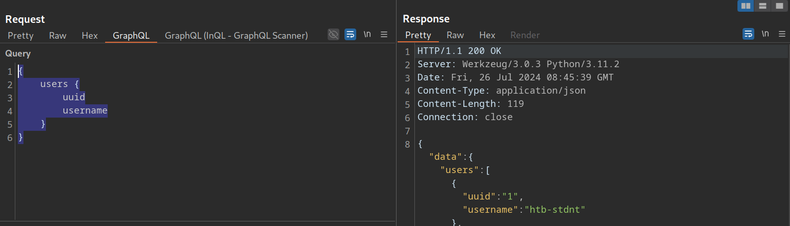
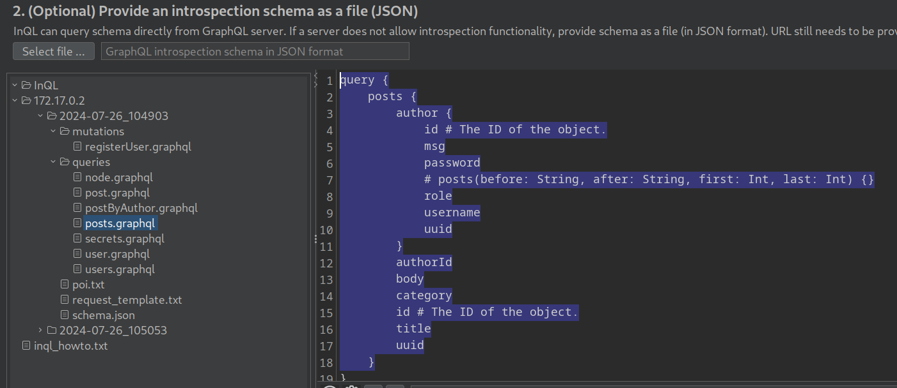

# Tools of the Trade

---

We have already discussed tools that can help us in the enumeration phase: [graphw00f](https://github.com/dolevf/graphw00f) and [graphql-voyager](https://github.com/graphql-kit/graphql-voyager). We will now discuss further tools to help us attack GraphQL APIs.

---

## GraphQL-Cop

We can use the tool [GraphQL-Cop](https://github.com/dolevf/graphql-cop), a security audit tool for GraphQL APIs. After cloning the GitHub repository and installing the required dependencies, we can run the `graphql-cop.py` Python script:

```
        shellsession
hiimeins@htb[/htb]$ python3 graphql-cop.py  -v

version: 1.13
```

We can then specify the GraphQL API's URL with the `-t` flag. GraphQL-Cop then executes multiple basic security configuration checks and lists all identified issues, which is an excellent baseline for further manual tests:

```
        shellsession
hiimeins@htb[/htb]$ python3 graphql-cop/graphql-cop.py -t http://172.17.0.2/graphql

[HIGH] Alias Overloading - Alias Overloading with 100+ aliases is allowed (Denial of Service - /graphql)
[HIGH] Array-based Query Batching - Batch queries allowed with 10+ simultaneous queries (Denial of Service - /graphql)
[HIGH] Directive Overloading - Multiple duplicated directives allowed in a query (Denial of Service - /graphql)
[HIGH] Field Duplication - Queries are allowed with 500 of the same repeated field (Denial of Service - /graphql)
[LOW] Field Suggestions - Field Suggestions are Enabled (Information Leakage - /graphql)
[MEDIUM] GET Method Query Support - GraphQL queries allowed using the GET method (Possible Cross Site Request Forgery (CSRF) - /graphql)
[LOW] GraphQL IDE - GraphiQL Explorer/Playground Enabled (Information Leakage - /graphql)
[HIGH] Introspection - Introspection Query Enabled (Information Leakage - /graphql)
[MEDIUM] POST based url-encoded query (possible CSRF) - GraphQL accepts non-JSON queries over POST (Possible Cross Site Request Forgery - /graphql)
```

---

## InQL

[InQL](https://github.com/doyensec/inql) is a Burp extension we can install via the `BApp Store` in Burp. After a successful installation, an `InQL` tab is added in Burp.

Furthermore, the extension adds `GraphQL` tabs in the Proxy History and Burp Repeater that enable simple modification of the GraphQL query without having to deal with the encompassing JSON syntax:



Furthermore, we can right-click on a GraphQL request and select `Extensions > InQL - GraphQL Scanner > Generate queries with InQL Scanner`:


Afterward, InQL generates introspection information. The information regarding all mutations and queries is provided in the `InQL` tab for the scanned host:



This is only a basic overview of InQL's functionality. Check out the official [GitHub repository](https://github.com/portswigger/inql) for more details.
