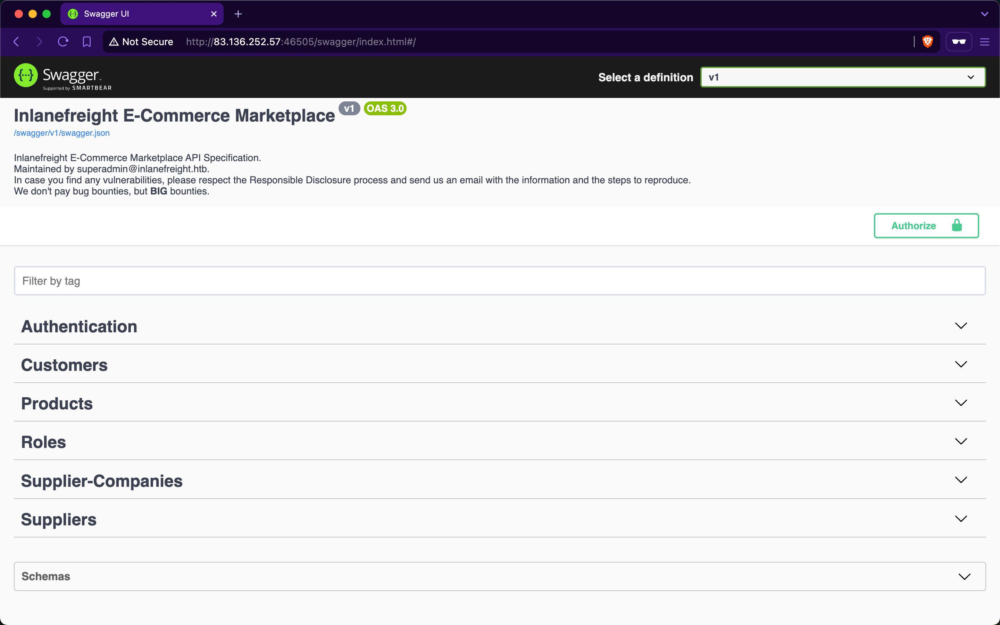

# Introduction to Lab

---

As we progress through the module, we will practice identifying and exploiting each of the OWASP API Top 10 Security Risks using a `RESTful` web API to fully understand these vulnerabilities.

## Inlanefreight E-Commerce Marketplace

Our loyal customer, Inlanefreight, has ventured into the world of e-commerce marketplaces with `Inlanefreight E-Commerce Marketplace`. The marketplace's business model enables customers to browse and purchase products offered by suppliers. Each supplier is associated with a specific company. The marketplace generates revenue by charging a fee for each product a customer purchases from a supplier.

To operate the marketplace and facilitate transactions between customers and suppliers, Inlanefreight has developed a multi-tenant web API that employs `Role-based Access Control` (`RBAC`) as its access control policy. Throughout the sections, we will interact with the API using different users with varying roles. Credentials associated with the `pentestercompany.com` domain represent supplier accounts, while those with `hackthebox.com` are identified as customer accounts.

For each user that we authenticate, they will have pre-assigned roles determined by the admin of `Inlanefreight E-Commerce Marketplace`. The admin has adopted a straightforward naming convention for roles: the roles share the same name as the endpoints to which they provide access to. For example, if a user has the role `Suppliers_GetAll`, it implies that the user is authorized to interact with the endpoint that retrieves all supplier records (which, in this case, is `/api/v1/suppliers`).

Our objective is to report any vulnerabilities found to the admin of `Inlanefreight E-Commerce Marketplace`. A detailed report of all discovered vulnerabilities will assist the admin in taking appropriate actions to secure the API. Each vulnerability will be mapped to its relevant [CWE](https://cwe.mitre.org/data/index.html) weakness.

### Swagger API User Interface

Despite the frontend of `Inlanefreight E-Commerce Marketplace` still being in active development, the web API can be accessed via a [Swagger](https://swagger.io/tools/swagger-ui/) UI at the `/swagger` path (make sure to include it after the port of the spawned target machine). We will use this interface throughout the module to explore and assess the security of the marketplace's API, which includes over 60 endpoints:

The key entities that the marketplace encompasses include `Customers`, `Products`, `Supplier-Companies`, and `Suppliers`. We will also interact with other entities as we progress through the sections.
