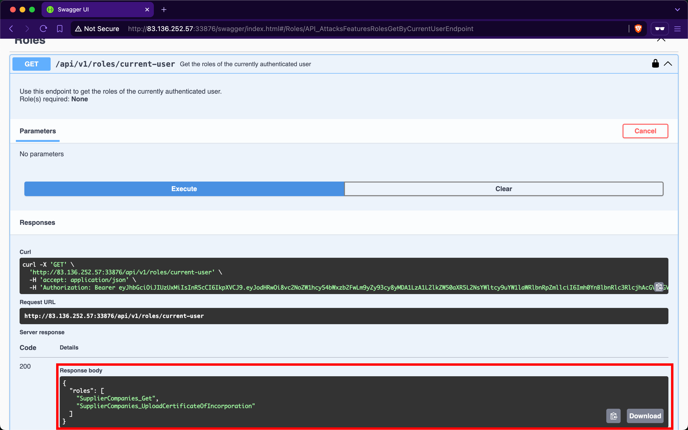
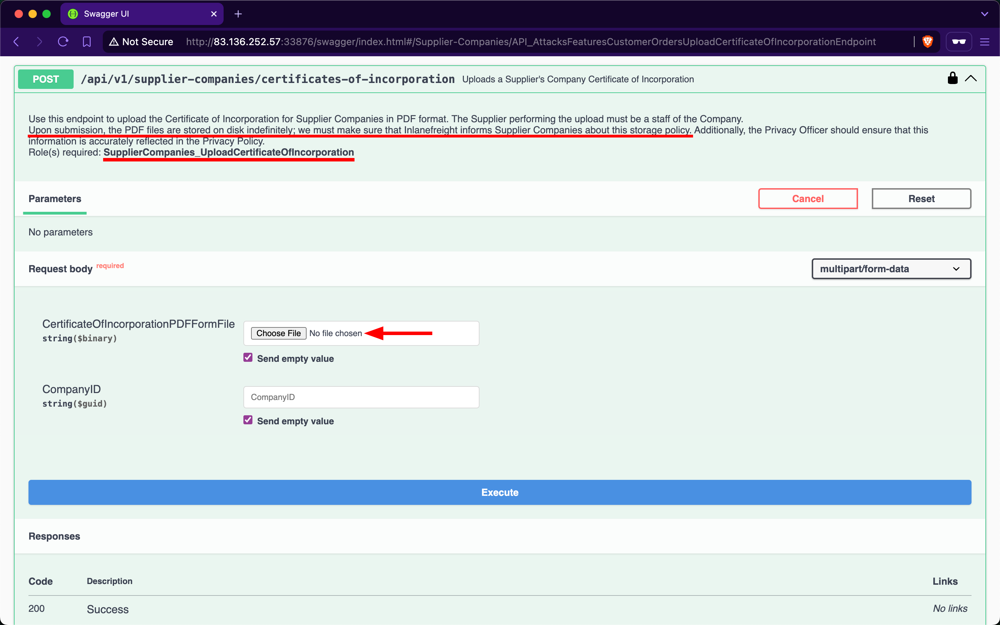
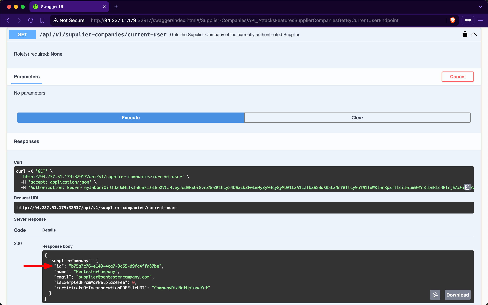
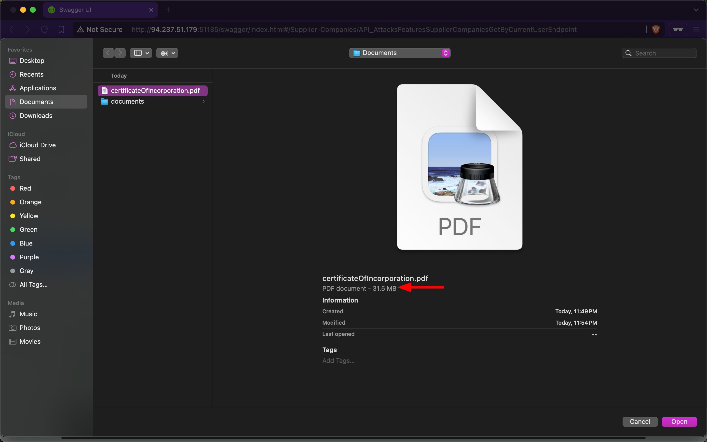
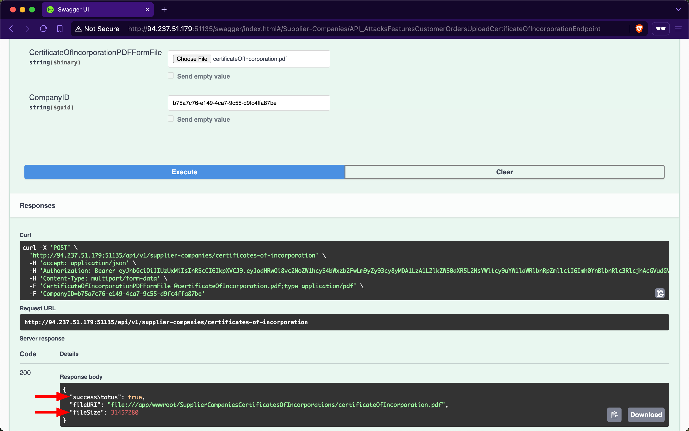
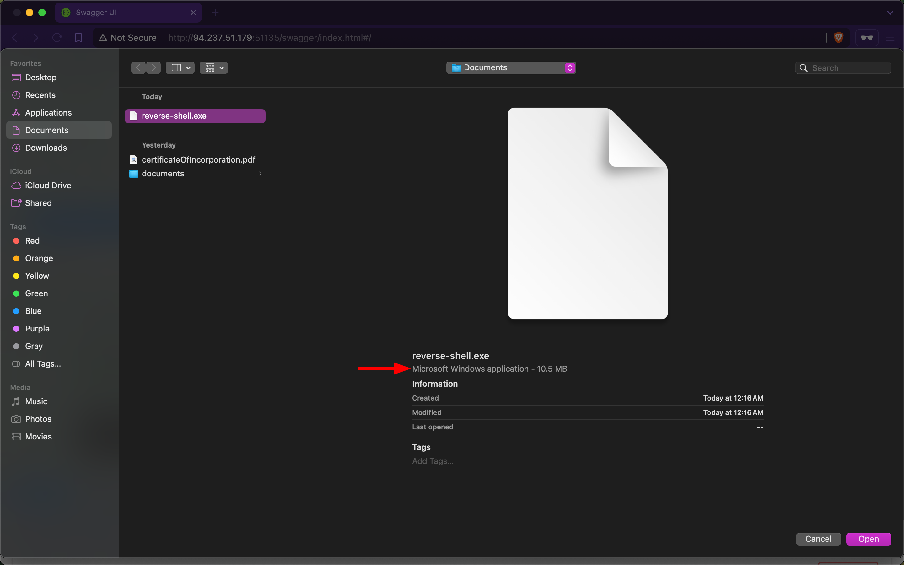
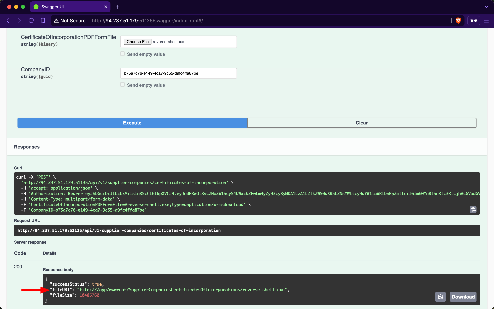

# Unrestricted Resource Consumption

---

File upload and download are fundamental features in all applications. For instance, in e-commerce marketplaces, suppliers require the ability to upload product images, while users need to view and download these files.

A web API is vulnerable to `Unrestricted Resource Consumption` if it fails to limit user-initiated requests that consume resources such as `network bandwidth`, `CPU`, `memory`, and `storage`. These resources incur significant costs, and without adequate safeguards—particularly effective `rate-limiting`—against excessive usage, users can exploit these vulnerabilities and cause financial damage.

## Uncontrolled Resource Consumption

The endpoint we will be practicing against is vulnerable to [CWE-400: Uncontrolled Resource Consumption](https://cwe.mitre.org/data/definitions/400.html).

### Scenario

The admin of `Inlanefreight E-Commerce Marketplace` has provided us with the credentials `htbpentester8@pentestercompany.com:HTBPentester8`, wanting us to assess what API vulnerabilities the user can exploit with their assigned roles.

After invoking `/api/v1/authentication/suppliers/sign-in` to sign in as a supplier and obtain a JWT, the `/api/v1/roles/current-user` endpoint shows that we have the roles `SupplierCompanies_Get` and `SupplierCompanies_UploadCertificateOfIncorporation`:



Checking the Supplier-Companies group, we notice only one endpoint related to the second role: the `/api/v1/supplier-companies/certificates-of-incorporation` `POST` endpoint. When expanding it, we see that it requires the `SupplierCompanies_UploadCertificateOfIncorporation` role and allows the staff of a supplier company to upload its certificate of incorporation as a PDF file, storing it on disk indefinitely:



Let us attempt to upload a large PDF file containing random bytes. First, we will use `/api/v1/supplier-companies/current-user` to get the supplier-company ID of the currently authenticated user, `b75a7c76-e149-4ca7-9c55-d9fc4ffa87be`:



Next, we will use [dd](https://man7.org/linux/man-pages/man1/dd.1.html) to create a file containing 30 random megabytes and assign it the `.pdf` extension:

```
        shellsession
hiimeins@htb[/htb]$ dd if=/dev/urandom of=certificateOfIncorporation.pdf bs=1M count=30

30+0 records in
30+0 records out
31457280 bytes (31 MB, 30 MiB) copied, 0.139503 s, 225 MB/s
```

Then, within the `/api/v1/supplier-companies/certificates-of-incorporation` `POST` endpoint, we will click on the 'Choose File' button and upload the file:



After invoking the endpoint, we notice that the API returns a successful upload message, along with the size of the uploaded file:



Because the endpoint does not validate whether the file size is within a specified range, the backend will save files of any size to disk. Additionally, if the endpoint does not implement rate-limiting, we can attempt to cause a denial-of-service by sending the file upload request repeatedly, consuming all available disk storage. Exploiting this vulnerability to consume all the disk storage of the marketplace will result in financial losses for the stakeholders of `Inlanefreight E-Commerce Marketplace`.

Additionally, we need to test whether the endpoint allows uploading files other than PDF files. Let us use `dd` again to generate a file with the `.exe` extension, filling it with random bytes:

```
        shellsession
hiimeins@htb[/htb]$ dd if=/dev/urandom of=reverse-shell.exe bs=1M count=10

10+0 records in
10+0 records out
10485760 bytes (10 MB, 10 MiB) copied, 0.0398348 s, 263 MB/s
```

Within the `/api/v1/supplier-companies/certificates-of-incorporation` `POST` endpoint, we will click on the 'Choose File' button and upload the file:



After invoking the endpoint, we notice that the API returns a successful upload message, indicating that the endpoint does not validate the file extension (additionally, notice how the files are stored within `wwwroot/SupplierCompaniesCertificatesOfIncorporations`):



If we manage to social engineer a system administrator of `Inlanefreight E-Commerce Marketplace` to open the file, the executable will run, potentially granting us a reverse shell (assuming we had used an actual reverse shell executable, such as those generated by `msfvenom`).

### Abusing Default Behaviors

After each request to upload files, we noticed that the file URI points to `wwwroot/SupplierCompaniesCertificatesOfIncorporations`, which is within the `wwwroot` directory.

The admin of `Inlanefreight E-Commerce Marketplace` has informed us that the web API is developed using [ASP.NET Core](https://dotnet.microsoft.com/en-us/apps/aspnet). By default, static files in the `wwwroot` directory are [publicly accessible](https://learn.microsoft.com/en-us/aspnet/core/fundamentals/static-files?view=aspnetcore-8.0#security-considerations-for-static-files). Let us try to download the previously uploaded `exe` file:

```
        shellsession
hiimeins@htb[/htb]$ curl -O http://94.237.51.179:51135/SupplierCompaniesCertificatesOfIncorporations/reverse-shell.exe

  % Total    % Received % Xferd  Average Speed   Time    Time     Time  Current
                                 Dload  Upload   Total   Spent    Left  Speed
100 10.0M  100 10.0M    0     0  11.4M      0 --:--:-- --:--:-- --:--:-- 11.4M
```

If we can enumerate file names within the `SupplierCompaniesCertificatesOfIncorporations` directory (and other directories within `wwwroot`), we could potentially access sensitive information about other customers of `Inlanefreight E-Commerce Marketplace`. Additionally, we could utilize the web API as cloud storage for malware that could be distributed to victims.

### Prevention

To mitigate the `Unrestricted Resource Consumption` vulnerability, the `/api/v1/supplier-companies/certificates-of-incorporation` `POST` endpoint should implement thorough validation mechanisms for both the size, extension and content of uploaded files. Validating the size of files prevents excessive consumption of server resources, such as disk space and memory, while ensuring that only authorized and expected file types are uploaded helps prevent potential security risks.

Implementing file size validation ensures that the uploaded files do not exceed specified limits, thereby preventing excessive consumption of server resources. Alternatively, validating file extensions ensures that only authorized file types, such as PDF or specific image formats, are accepted. This prevents malicious uploads of executable files (`exe`, `bat`, `sh`) or other potentially harmful file types that could compromise server security. Implementing strict file extension validation, coupled with server-side checks, helps enforce security policies and prevents unauthorized access and execution of files.

Integrating antivirus scanning tools like [ClamAV](https://www.clamav.net/) adds a layer of security by scanning file contents for known malware signatures before saving them to disk. This proactive measure helps detect and prevent the uploading of infected files that could potentially compromise server integrity.

Moreover, enforcing robust authentication and authorization mechanisms ensures that only authenticated users with appropriate privileges can upload files and access resources in publicly accessible directories such as `wwwroot`.
