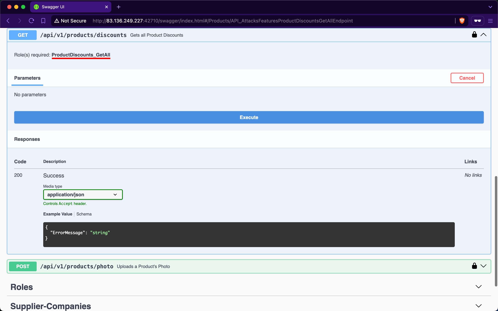
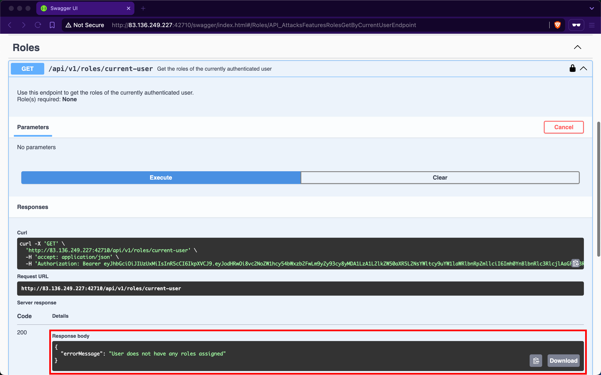
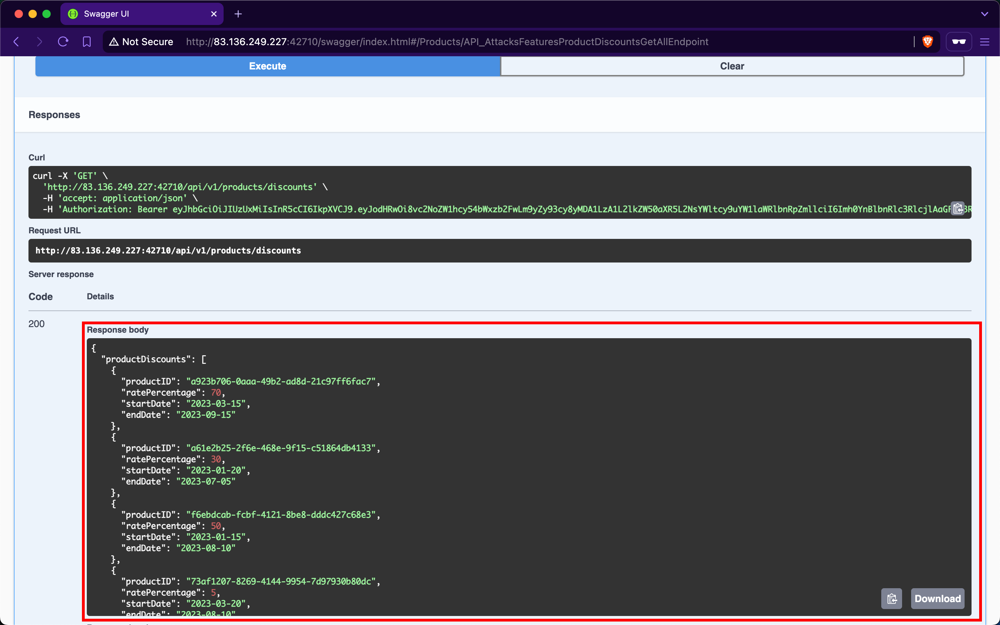

# Broken Function Level Authorization

---

A web API is vulnerable to `Broken Function Level Authorization` (`BFLA`) if it allows unauthorized or unprivileged users to interact with and invoke privileged endpoints, granting access to sensitive operations or confidential information. The difference between `BOLA` and `BFLA` is that, in the case of `BOLA`, the user is authorized to interact with the vulnerable endpoint, whereas in the case of `BFLA`, the user is not.

## Exposure of Sensitive Information to an Unauthorized Actor

The endpoint we will be practicing against is vulnerable to [CWE-200: Exposure of Sensitive Information to an Unauthorized Actor](https://cwe.mitre.org/data/definitions/200.html).

### Scenario

The admin of `Inlanefreight E-Commerce Marketplace` has provided us with the credentials `htbpentester9@hackthebox.com:HTBPentester9`, wanting us to assess what API vulnerabilities the user can exploit with their assigned roles.

After invoking `/api/v1/authentication/customer/sign-in` to sign in as a customer and obtain a JWT, we need to hunt for endpoints that require authorization but allow unauthorized users to interact with them. One interesting endpoint under the Products group, `/api/v1/products/discounts`, seems to retrieve all product discounts, however, it requires authenticated users to have the `ProductDiscounts_GetAll` role:

After checking our roles using the `/api/v1/roles/current-user` endpoint, we will discover that the currently authenticated user does not have any assigned:

Despite not having any roles, if we attempt to invoke the `/api/v1/products/discounts` endpoint, we notice that it returns data containing all the discounts for products:

Although the web API developers intended that only authorized users with the `ProductDiscounts_GetAll` role could access this endpoint, they did not implement the role-based access control check.

### Prevention

To mitigate the `BFLA` vulnerability, the `/api/v1/products/discounts` endpoint should enforce an authorization check at the source-code level to ensure that only users with the `ProductDiscounts_GetAll` role can interact with it. This involves verifying the user's roles before processing the request, ensuring that unauthorized users are denied access to the endpoint's functionality.
