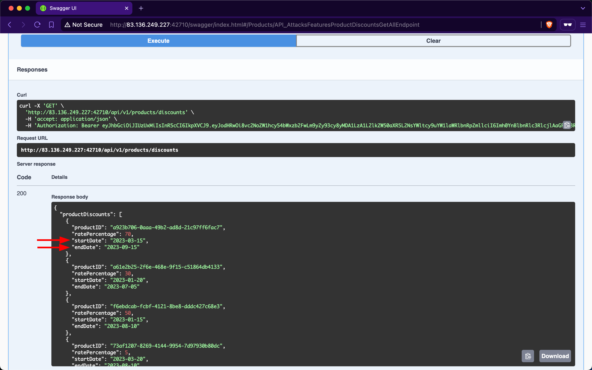

# Unrestricted Access to Sensitive Business Flows

---

All businesses operate to generate revenue; however, if a web API exposes operations or data that allows users to abuse them and undermine the system (for example, by buying goods at a discounted price), it becomes vulnerable to `Unrestricted Access to Sensitive Business Flows`. An API endpoint is vulnerable if it exposes a sensitive business flow without appropriately restricting access to it.

## Scenario

In the previous section, we exploited a `BFLA` vulnerability and gained access to product discount data. This data exposure also leads to `Unrestricted Access to Sensitive Business Flows` because it allows us to know the dates when supplier companies will discount their products and the corresponding discount rates. For example, if we want to buy the product with ID `a923b706-0aaa-49b2-ad8d-21c97ff6fac7`, we should purchase it between `2023-03-15` and `2023-09-15` because it will be 70% off its original price:

Additionally, if the endpoint responsible for purchasing products does not implement rate-limiting (i.e., it suffers from `Unrestricted Resource Consumption`), we can purchase all available stock on the day the discount starts and resell the products later at their original price or at a higher price after the discount ends.

### Prevention

To mitigate the `Unrestricted Access to Sensitive Business Flows` vulnerability, endpoints exposing critical business operations, such as `/api/v1/products/discounts`, should implement strict access controls to ensure that only authorized users can view or interact with sensitive data.
