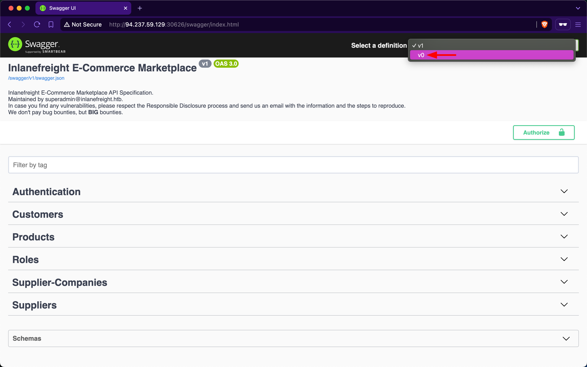
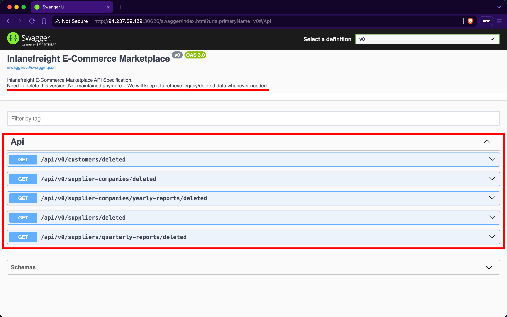
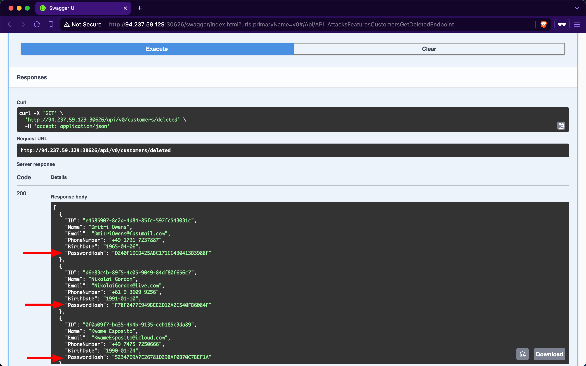

# Improper Inventory Management

---

Maintaining accurate and up-to-date documentation is essential for web APIs, especially considering their reliance on third-party users who need to understand how to interact with the API effectively.

However, as a web API matures and undergoes changes, it is crucial to implement proper versioning practices to avoid security pitfalls. Improper inventory management of APIs, including inadequate versioning, can introduce security misconfigurations and increase the attack surface. This can manifest in various ways, such as outdated or incompatible API versions remaining accessible, creating potential entry points for unauthorized users.

## Scenario

In the previous sections, we have primarily interacted with `v1` of the `Inlanefreight E-Commerce Marketplace` web API. However, upon examining the `Swagger` UI's drop-down list for 'Select a definition', we discover the existence of an additional version, `v0`:

Upon reviewing the description of `v0`, it is indicated that this version contains legacy and deleted data, serving as an unmaintained backup that should be removed. However, upon inspecting the endpoints, we will notice that none of them display a 'lock' icon, indicating that they do not require any form of authentication:

Upon invoking the `/api/v0/customers/deleted` endpoint, the API responds by exposing deleted customer data, including sensitive password hashes:

Due to oversight by the developers in neglecting to remove the `v0` endpoints, we gained unauthorized access to deleted data of former customers. This issue was exacerbated by an `Excessive Data Exposure` vulnerability in the `/api/v0/customers/deleted` endpoint, which allowed us to view customer password hashes. With this exposed information, we could attempt password cracking. Given the common practice of password reuse, this could potentially compromise active accounts, particularly if the same customers re-registered using the same password.

### Prevention

Effective versioning ensures that only the intended API versions are exposed to users, with older versions properly deprecated or sunset. By thoroughly managing the API inventory, `Inlanefreight E-Commerce Marketplace` can minimize the risk of exposing vulnerabilities and maintain a secure user interface.

To mitigate the `Improper Inventory Management` vulnerability, developers at `Inlanefreight E-Commerce Marketplace` should either remove `v0` entirely or, at a minimum, restrict access exclusively for local development and testing purposes, ensuring it remains inaccessible to external users. If neither option is viable, the endpoints should be protected with stringent authentication measures, permitting interaction solely by administrators.
